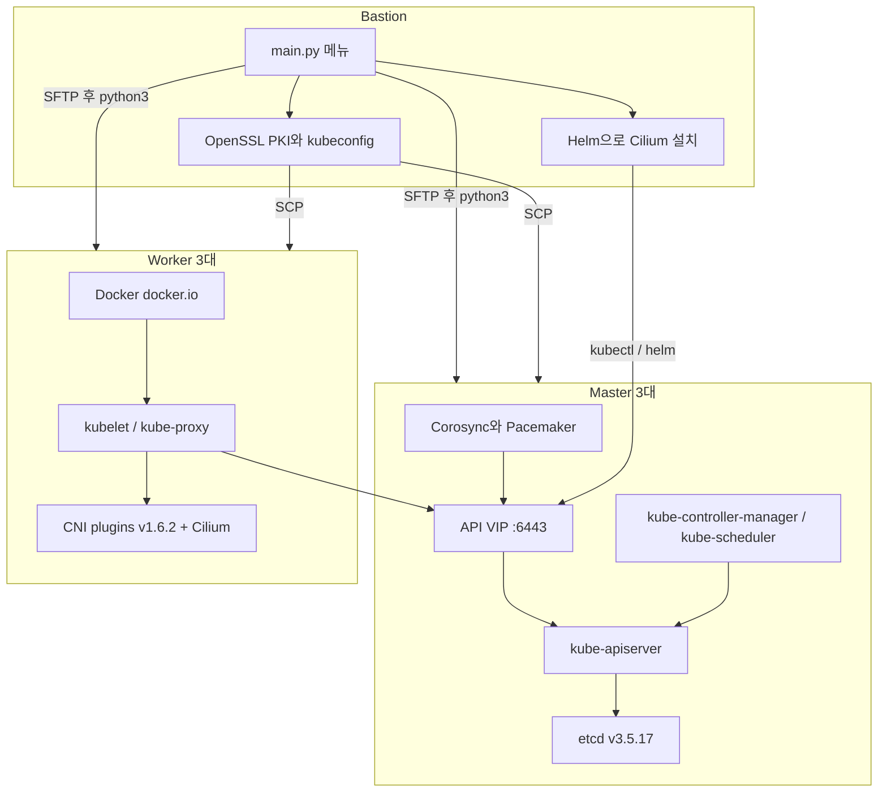

# K8s-Hardway-Installation

[](https://www.python.org/)
[](https://kubernetes.io/)
[](https://etcd.io/)
[](https://cilium.io/)
[](https://helm.sh/)
[](https://docs.docker.com/engine/)
[](https://clusterlabs.org/)

Bastion 메뉴로 구동하는 Python 스크립트. Kubernetes v1.29.7 control plane 3대와 worker 3대를 바이너리와 systemd 유닛으로 설치하는 hard-way 자동화.

이 문서는 저장소에 들어 있는 스크립트의 상수와 호출 순서만 적는다. 설치 성공 로그나 테스트 결과는 트리에 없다.

## 배경과 목적

관리형 클러스터와 kubeadm은 API server, etcd, kubelet, CNI의 경계를 설치 단계에서 숨긴다. 이 저장소는 그 경계를 랩에서 직접 맞추기 위한 스크립트 모음이다. Bastion에서 인증서와 kubeconfig를 만들고, SSH로 노드에 스크립트를 올려 etcd와 static control plane을 기동한 뒤, Pacemaker VIP 뒤로 API를 묶고 worker를 붙인다. CNI는 Helm으로 Cilium 1.15.4를 설치한다.

다루는 범위는 클러스터 부트스트랩이다. 메트릭·로그 수집 구성은 이 트리에 없다. 구성 요소가 파일 경로, 유닛, 인증서 SAN으로 나뉘어 있어, 노드가 붙지 않을 때 어느 계층인지 스크립트 단위로 따라갈 수 있다.

클러스터 이름은 `sunjae-k8s-hardway`다. kubeconfig와 `kube-controller-manager`의 `--cluster-name`이 이 문자열을 쓴다.

## 수동 설치 문서

스크립트가 자동화한 절차를 손으로 한 단계씩 따라간 기록은 [`docs/`](docs/README.md)에 있다. Bastion 네트워크 구성부터 PKI, kubeconfig, etcd, 컨트롤 플레인, Worker 조인(수동 인증서 / TLS bootstrap), Cilium·CoreDNS, 통신 테스트까지 12개 장으로 나눴다.

| 장 | 내용 | 대응 스크립트 |
| --- | --- | --- |
| [01](docs/01-overview.md) · [02](docs/02-bastion-network.md) | 환경, VM 구성, Bastion NAT·hosts | - |
| [03](docs/03-certificates.md) · [04](docs/04-kubeconfig.md) · [05](docs/05-apiserver-etcd-sa-certs.md) | CA·클라이언트 인증서, kubeconfig, API/etcd SAN, SA 키 | `cert_create.py` |
| [06](docs/06-distribute-certs.md) | 인증서·kubeconfig 배포 | `cert_transfer.py` |
| [07](docs/07-etcd.md) | etcd 3노드 | `etcd_setup.py`, `etcd_verify.py` |
| [08](docs/08-control-plane.md) | apiserver, controller-manager, scheduler | `control_plane_setup.py` |
| [09](docs/09-worker01.md) | Worker01 (수동 인증서) | `cert_create_worker.py`, `worker_node_setup.py` |
| [10](docs/10-cilium-coredns.md) · [11](docs/11-network-test.md) | Cilium, RBAC, CoreDNS, 통신 테스트 | `cni_setup.py` |
| [12](docs/12-tls-bootstrap-workers.md) | TLS bootstrap으로 Worker02·03 조인 | `tls_setup.py`, `cert_sub_worker_node_transfer.py`, `sub_worker_node_setup.py` |

문서의 비밀번호, 개인 키, bootstrap token은 자리표시자로 바꿨다.

## 아키텍처

Bastion이 오케스트레이션 지점이다. `main.py`는 로컬 스크립트를 `python3`로 실행하거나, 대상 노드의 `/root/<스크립트>`로 SFTP 전송한 뒤 `python3`로 실행한다. Master 단계(메뉴 4·5·6)와 Worker 2·3 단계(메뉴 12)는 스레드로 동시에 돌린다.



| 구성 요소 | 구현 | 근거 스크립트 |
| --- | --- | --- |
| API 진입점 | Pacemaker `ocf:heartbeat:IPaddr2` 리소스 `kubernetes_api_port`, netmask `/32` | `pcs_setup.py` |
| etcd | 3멤버, client 2379 / peer 2380, TLS | `etcd_setup.py`, `etcd_verify.py` |
| Control plane | `kube-apiserver`, `kube-controller-manager`, `kube-scheduler` systemd 유닛. `--apiserver-count=3`, advertise 주소는 VIP | `control_plane_setup.py` |
| PKI | OpenSSL CA, admin, controller-manager, scheduler, proxy, service account, API server SAN, etcd server | `cert_create.py` |
| Worker 1 | 노드 인증서를 Bastion에서 서명하고 kubelet에 파일로 전달. kube-proxy mode `iptables` | `cert_create_worker.py`, `worker_node_setup.py` |
| Worker 2·3 | bootstrap token으로 kubelet 기동. kube-proxy mode `ipvs` | `tls_setup.py`, `cert_sub_worker_node_transfer.py`, `sub_worker_node_setup.py` |
| CNI | Helm chart `cilium/cilium` 1.15.4, namespace `kube-system` | `cni_setup.py` |
| 부가 매니페스트 | API server → kubelet RBAC, CoreDNS ConfigMap, `nicolaka/netshoot` DaemonSet | `cni_setup.py` |

네트워크 상수는 스크립트에 이렇게 적혀 있다.

| 항목 | 값 | 위치 |
| --- | --- | --- |
| Service CIDR | `10.231.0.0/18` | `control_plane_setup.py` |
| API ClusterIP (SAN) | `10.231.0.1` | `cert_create.py` |
| clusterDNS | `10.231.0.10` | worker kubelet 설정 |
| Pod CIDR (`--cluster-cidr`) | `10.240.0.0/13` | controller-manager, kube-proxy |
| NodePort | `30000-32767` | `kube-apiserver` |
| Kubernetes / kubectl | `v1.29.7` | control plane, worker, `cert_create.py` |
| etcd | `v3.5.17` | `etcd_setup.py` |
| Helm / Cilium | `v3.9.4` / `1.15.4` | `cni_setup.py` |
| CNI plugins | `v1.6.2` | worker 스크립트 |

노드 IP, VIP, 호스트명은 스크립트 상단 상수다. 이 문서는 그 값과 SSH 비밀번호, bootstrap token 원문을 다시 적지 않는다. 실행 전에 주소 상수를 랩 값으로 바꾼다. SSH 비밀번호는 소스에 두지 않고 `SSH_PASSWORD` 환경 변수로 받는다.

## 디렉터리 구조

실행 진입점과 단계 스크립트는 저장소 루트에 있다. Python 의존성 잠금 파일과 `.env` 예제는 포함되어 있지 않다.

```text
.
├── main.py                              # Bastion 메뉴. 로컬 실행 또는 SSH로 원격 실행
├── pcs_setup.py                         # Master에 Pacemaker/Corosync와 API VIP
├── cert_create.py                       # Bastion 패키지, kubectl, CA/kubeconfig
├── cert_transfer.py                     # 인증서·kubeconfig를 전 노드로 SCP
├── etcd_setup.py                        # Master에서 etcd 설치와 systemd
├── etcd_verify.py                       # etcd endpoint status / health
├── control_plane_setup.py               # apiserver, controller-manager, scheduler
├── cert_create_worker.py                # Worker 1 노드 인증서와 bootstrap Secret
├── worker_node_setup.py                 # Worker 1의 Docker, kubelet, kube-proxy
├── cni_setup.py                         # Helm, Cilium, RBAC, CoreDNS ConfigMap, netshoot
├── tls_setup.py                         # bootstrap token Secret과 CSR RBAC
├── cert_sub_worker_node_transfer.py     # Worker 2·3에 ca.crt, kube-proxy.kubeconfig
├── sub_worker_node_setup.py             # Worker 2·3 kubelet TLS bootstrap
├── docs/                                # 수동 설치 문서 (01~12장, images/)
└── README.md
```

## 사전 요구 사항

스크립트가 호출하는 명령 기준이다.

- Bastion과 노드가 Debian 계열이다. `apt` / `apt-get`, `dpkg`, `systemd`를 사용한다.
- Bastion에 `python3`, `pip`, `wget`, `openssl`이 있고, 노드로 `root` SSH가 된다.
- `main.py`는 시작 시 `paramiko`를 import한다. 메뉴 1번의 `pcs_setup.py`도 같다. `paramiko`와 `scp` 설치는 메뉴 2번 `cert_create.py` 안에 있으므로, 그 전에 Bastion에 패키지가 있어야 `python3 main.py`가 뜬다.
- Master의 etcd 스크립트는 `ip addr show ens33`으로 자신의 주소를 읽는다. 인터페이스 이름이 `ens33`일 때 그대로 동작한다.
- etcd `--name`은 해당 머신의 `hostname -s`다. 이 값이 `etcd_setup.py`의 `MASTER_NODES` `name`과 같아야 initial cluster 이름과 맞는다.
- 바이너리 다운로드 대상은 `storage.googleapis.com`, `github.com/etcd-io/etcd`, `github.com/containernetworking/plugins`, `get.helm.sh`, `helm.cilium.io`다.
- 컨테이너 런타임 패키지는 worker의 `docker.io`다.
- SSH 사용자는 `root`다. `main.py`가 원격으로 돌리는 단계(4, 5, 6, 8, 12)는 실행 시 `getpass`로 비밀번호를 받는다. `pcs_setup.py`, `cert_transfer.py`, `cert_create_worker.py`, `cert_sub_worker_node_transfer.py`는 `SSH_PASSWORD` 환경 변수를 읽는다.

Bastion 준비 예:

```bash
sudo apt-get update
sudo apt-get install -y python3 python3-pip wget openssl
python3 -m pip install paramiko scp
```

`cert_create.py`가 나중에 다시 실행하는 패키지 설치는 `apt update`, `apt upgrade`, `apt install net-tools htop vim openssl ipset python3-pip`, `pip install scp paramiko`다.

## 설치와 실행

작업 디렉터리는 저장소 루트다. `main.py`가 `os.getcwd()`에서 스크립트를 찾는다.

```bash
git clone https://github.com/qkrtjswo03/K8s-Hardway-Installation.git
cd K8s-Hardway-Installation
python3 main.py
```

프롬프트 `SSH 비밀번호 입력:` 다음에 메뉴가 나온다. `main.py`에 적힌 순서대로 1번부터 12번까지 고른다.

```text
1.  VIP 설정 (Pacemaker/Corosync)          pcs_setup.py                         Bastion 로컬
2.  인증서 생성                            cert_create.py                       Bastion 로컬
3.  인증서 전송                            cert_transfer.py                     Bastion 로컬, 전 노드 SCP
4.  ETCD 클러스터 구성                     etcd_setup.py                        Master 3대 동시
5.  ETCD 상태 검증                         etcd_verify.py                       Master 3대 동시
6.  Control Plane 설정                     control_plane_setup.py               Master 3대 동시
7.  Worker Node 인증서 생성 및 전송        cert_create_worker.py                Bastion 로컬, Worker 1만 서명
8.  Main Worker 노드 설정                  worker_node_setup.py                 Worker 목록의 첫 노드
9.  CNI 세팅 (Bastion Cilium)              cni_setup.py                         Bastion 로컬
10. TLS Bootstrapping 설정                 tls_setup.py                         Bastion 로컬
11. Sub Worker Node 인증서 전송            cert_sub_worker_node_transfer.py     Worker 2·3 SCP
12. Sub Worker Node 초기 세팅              sub_worker_node_setup.py             Worker 2·3 동시
13. 종료
```

원격 단계는 Bastion이 스크립트를 `/root/<파일이름>`으로 복사하고 `chmod +x` 한 뒤 `python3 /root/<파일이름>`을 실행한다. 같은 파일을 노드에서 직접 돌릴 때는 root로 저장소의 해당 파일을 실행한다.

```bash
python3 pcs_setup.py
python3 cert_create.py
python3 cert_transfer.py
python3 etcd_setup.py
python3 etcd_verify.py
python3 control_plane_setup.py
python3 cert_create_worker.py
python3 worker_node_setup.py
python3 cni_setup.py
python3 tls_setup.py
python3 cert_sub_worker_node_transfer.py
python3 sub_worker_node_setup.py
```

각 단계가 하는 일은 아래와 같다.

1. **VIP.** Master에 `pacemaker`, `corosync`, `pcs`를 설치하고 `corosync.conf`와 authkey를 배포한다. `stonith-enabled=false`, `resource-stickiness=60`을 설정한 뒤 VIP 리소스를 만든다. Corosync 클러스터 이름은 `lbcluster`, `expected_votes`는 3이다. 여기의 노드 이름 상수(`master1`, `master2`, `master3`)는 etcd 스크립트의 호스트명 상수와 별개다.
2. **인증서.** `/root/hardway/certs`에 CA(10년), 클라이언트 인증서(1년), API server SAN, etcd 인증서(10년)를 만든다. SAN DNS는 `kubernetes`, `kubernetes.default`, `kubernetes.default.svc`, `kubernetes.default.svc.cluster.local`이다. admin, controller-manager, scheduler, kube-proxy kubeconfig의 server는 `https://<VIP>:6443`이다. `admin.kubeconfig`를 `/root/.kube/config`로 복사하고 kubectl `v1.29.7`이 없으면 받아 `/usr/local/bin`에 둔다.
3. **전송.** Master에는 CA, API server, service account, etcd 인증서와 admin / controller-manager / scheduler kubeconfig를 `/home/ubuntu/hardway/certs`로 보낸다. Worker에는 `ca.crt`와 `kube-proxy.kubeconfig`만 같은 경로로 보낸다.
4. **etcd.** 바이너리를 `/usr/local/bin`에 설치하고 인증서를 `/etc/ssl/etcd/ssl`로 복사한다. 데이터 디렉터리는 `/var/lib/etcd`(mode 700). 클러스터 토큰 상수는 `etcd-cluster-0`, `--initial-cluster-state=new`다.
5. **etcd 검증.** `ETCDCTL_API=3`으로 `endpoint status --write-out=table`과 `endpoint health`를 찍는다. 인증서 경로는 `/etc/ssl/etcd/ssl`.
6. **Control plane.** `kubectl`, `kube-apiserver`, `kube-controller-manager`, `kube-scheduler`를 설치한다. 인증서는 `/etc/kubernetes/ssl`, kubeconfig는 `/etc/kubernetes`다. `service-account.pub`는 `openssl rsa -pubout`으로 만든다. admission은 `NodeRestriction,ServiceAccount`, authorization은 `Node,RBAC`, bootstrap token auth는 켜져 있다. controller-manager는 `--leader-elect=true`와 `--allocate-node-cidrs=true`다. scheduler는 `127.0.0.1`에 바인드한다.
7. **Worker 1 인증서.** `manual_cert`가 참인 첫 worker만 노드 인증서와 kubeconfig를 만든다. 파일은 그 노드의 `/etc/kubernetes/ssl`과 `/etc/kubernetes/<hostname>.kubeconfig`로 SCP한다. 이어서 bootstrap token Secret을 `kubectl apply`한다. 같은 Secret 적용이 10번에도 있다.
8. **Worker 1 노드.** `docker.io` 설치, swap off, kubelet/kube-proxy/kubectl `v1.29.7`, CNI plugins를 `/opt/cni/bin`에 푼다. kubelet은 노드 인증서 파일로 `--register-node=true`다. 인증서 원본 경로는 `/home/ubuntu/hardway/certs`다.
9. **CNI.** Helm이 없으면 `v3.9.4`를 `/usr/bin/helm`에 설치하고 `helm install cilium cilium/cilium --version 1.15.4 --namespace kube-system --create-namespace`를 실행한다. Pod CIDR은 이 인자로 전달되지 않으며, controller-manager와 kube-proxy의 `10.240.0.0/13`에만 적혀 있다. 이어서 `system:kube-apiserver-to-kubelet` ClusterRole과 binding, CoreDNS ConfigMap, netshoot DaemonSet을 apply하고 `kubectl get pods`와 `kubectl get svc`를 `kube-system`에서 실행한다.
10. **TLS bootstrap.** token Secret과 ClusterRoleBinding `create-csrs-for-bootstrapping`(`system:node-bootstrapper`), `auto-approve-csrs-for-group`(`certificatesigningrequests:nodeclient`)을 apply한다. 그룹은 `system:bootstrappers`다.
11. **Worker 2·3 파일.** `ca.crt`를 `/etc/kubernetes/ssl`, `kube-proxy.kubeconfig`를 `/etc/kubernetes`로 보낸다.
12. **Worker 2·3 노드.** Docker와 `ipset`, 바이너리, CNI plugins, bootstrap kubeconfig, kubelet/kube-proxy 유닛을 만든다. kubelet은 `--bootstrap-kubeconfig`와 `--kubeconfig=/etc/kubernetes/kubelet.kubeconfig`를 쓴다. `rotateCertificates: true`다.

## 설정

토폴로지를 바꾸려면 같은 의미를 가진 상수를 함께 수정한다.

> **비밀 값은 저장소에 넣지 않는다.** `pcs_setup.py`, `cert_transfer.py`, `cert_create_worker.py`, `cert_sub_worker_node_transfer.py`는 SSH 비밀번호를 `os.environ.get("SSH_PASSWORD")`로 읽고, 값이 없으면 바로 종료한다. 실행 전에 Bastion 셸에서 `export SSH_PASSWORD='...'`를 한 번 설정한다(셸 기록에 남기지 않으려면 `read -rs SSH_PASSWORD && export SSH_PASSWORD`).
> bootstrap token은 `CHANGE_ME_TOKEN_ID.CHANGE_ME_BOOTSTRAP_TOKEN_SECRET` 자리표시자로 되어 있다. `kubeadm token generate` 등으로 `[a-z0-9]{6}.[a-z0-9]{16}` 형식 값을 만들어 아래 세 파일에서 같은 값으로 바꾼다.

| 바꿀 값 | 파일 |
| --- | --- |
| Master / Worker 주소 | `main.py`, `cert_create.py`, `cert_transfer.py`, `cert_create_worker.py`, `cert_sub_worker_node_transfer.py`, `etcd_setup.py`, `etcd_verify.py`, `control_plane_setup.py`, `pcs_setup.py`, `worker_node_setup.py`, `sub_worker_node_setup.py` |
| VIP와 API server URL | `cert_create.py`, `cert_create_worker.py`, `control_plane_setup.py`, `pcs_setup.py`, `sub_worker_node_setup.py` |
| 호스트명 | `cert_transfer.py`, `cert_create_worker.py`, `etcd_setup.py`, `worker_node_setup.py`. etcd는 추가로 OS `hostname -s` |
| Corosync `BINDNETADDR`, 노드 이름 `master1`–`master3` | `pcs_setup.py` |
| SSH 비밀번호 | `SSH_PASSWORD` 환경 변수 (`pcs_setup.py`, `cert_transfer.py`, `cert_create_worker.py`, `cert_sub_worker_node_transfer.py`가 읽음) |
| `main.py` 원격 단계의 비밀번호 | 실행 중 `getpass` 입력. 파일에 저장하지 않는다 |
| bootstrap token | `cert_create_worker.py`, `tls_setup.py`, `sub_worker_node_setup.py` |
| 클러스터 이름 | `cert_create.py`의 `KUBE_CLUSTER_NAME`, `cert_create_worker.py`의 `CLUSTER_NAME`, `control_plane_setup.py`의 `--cluster-name` |
| NIC 이름 | `etcd_setup.py`의 `ip addr show ens33` |

`pcs_setup.py`의 `BINDNETADDR`과 그 파일의 노드 주소 상수는 서로 다른 대역으로 적혀 있다. Corosync를 올리기 전에 실제 인터페이스 대역과 맞춘다.

Cilium 설치 명령은 위 9번의 `helm install` 한 줄이다. Pod CIDR `10.240.0.0/13`은 controller-manager와 kube-proxy 설정에 있다.

Worker 1의 kube-proxy mode는 `iptables`이고 Worker 2·3은 `ipvs`다. `ipset` 패키지 설치는 `sub_worker_node_setup.py`에만 있다.

## 문제 해결

실패 메시지는 각 스크립트가 표준 출력과 아래 로그에 남긴다.

| 로그 | 스크립트 |
| --- | --- |
| `/root/hardway/cert_generation.log` | `cert_create.py` |
| `/root/hardway/certs/node_cert_transfer.log` | `cert_transfer.py` |
| `/root/hardway/certs/worker_cert_setup.log` | `cert_create_worker.py` |
| `/root/hardway/etcd_setup.log` | `etcd_setup.py` |
| `/root/hardway/etcd_verification.log` | `etcd_verify.py` |
| `/home/ubuntu/hardway/k8s_setup.log` | `control_plane_setup.py` |
| `/root/worker01_setup.log` | `worker_node_setup.py` |
| `/root/bastion_setup.log` | `cni_setup.py` |
| `/root/tls_bootstrapping_setup.log` | `tls_setup.py` |
| `/root/<hostname>_setup.log` | `sub_worker_node_setup.py` |

스크립트에 보이는 확인 지점은 다음과 같다.

- **`python3 main.py`가 즉시 죽는다.** `paramiko` import 실패다. 위 사전 설치를 Bastion에서 먼저 한다. 메뉴 2번이 `pip install`을 실행하지만, 그 코드는 메뉴가 뜬 뒤에 도달한다.
- **메뉴 1·3·7·11만 SSH 인증에 실패한다.** 이 네 스크립트는 `getpass` 입력을 쓰지 않고 `SSH_PASSWORD` 환경 변수를 쓴다. 변수가 비어 있으면 시작하자마자 종료하고, 값이 틀리면 인증에 실패한다. 4·5·6·8·12는 `main.py`에 입력한 비밀번호로 `root` 접속한다.
- **etcd가 멤버를 못 찾는다.** `etcd_setup.py`는 `ens33`의 IPv4와 `hostname -s`로 유닛을 만든다. 인터페이스 이름이 다르거나 short hostname이 `MASTER_NODES`의 `name`과 다르면 `--initial-cluster`와 `--name`이 어긋난다. 인증서 파일은 `/etc/ssl/etcd/ssl/ca.crt`, `etcd-server.crt`, `etcd-server.key`다. `control_plane_setup.py`의 apiserver도 etcd 클라이언트 인증서를 이 경로에서 읽는다.
- **Control plane이 인증서 복사에서 멈춘다.** 복사 원본은 노드의 `/home/ubuntu/hardway/certs`다. 메뉴 3번 `cert_transfer.py`가 Master에 넣어 두는 경로와 같다.
- **Worker 1이 `필수 파일 누락`으로 끝난다.** `worker_node_setup.py`는 `/home/ubuntu/hardway/certs`에서 `ca.crt`, `<hostname>.crt`, `<hostname>.key`, `kube-proxy.kubeconfig`를 요구하고, 없으면 `FileNotFoundError`를 낸다. `cert_transfer.py`가 worker로 보내는 파일은 `ca.crt`와 `kube-proxy.kubeconfig`뿐이다. 노드 인증서와 노드 kubeconfig는 `cert_create_worker.py`가 `/etc/kubernetes/ssl`과 `/etc/kubernetes/<hostname>.kubeconfig`로 직접 보낸다.
- **Cilium 이후에도 CoreDNS Pod가 없다.** `cni_setup.py`의 CoreDNS 적용 대상은 ConfigMap `coredns`뿐이다. Deployment와 Service는 그 YAML에 없다. netshoot는 namespace 없이 DaemonSet `netshoot-cluster`로 apply되므로 기본 namespace에 생긴다. 9번은 메뉴상 Worker 2·3 합류(11·12번)보다 먼저다. 9번 끝의 `kubectl get pods -n kube-system`은 그 시점의 객체만 보여 준다.
- **bootstrap token이 두 번 apply된다.** 7번 `cert_create_worker.py`와 10번 `tls_setup.py`가 같은 token id의 Secret을 만든다. Worker 2·3의 kubelet token 상수는 `sub_worker_node_setup.py`에 따로 있다. 세 곳의 token이 같아야 한다.
- **VIP 리소스가 이미 있다.** `pcs_setup.py`는 `pcs resource show kubernetes_api_port` 결과에 그 이름이 있으면 지운 다음 다시 `pcs resource create`를 한다.
