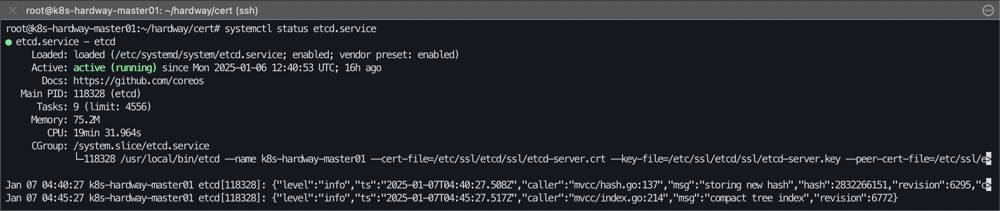
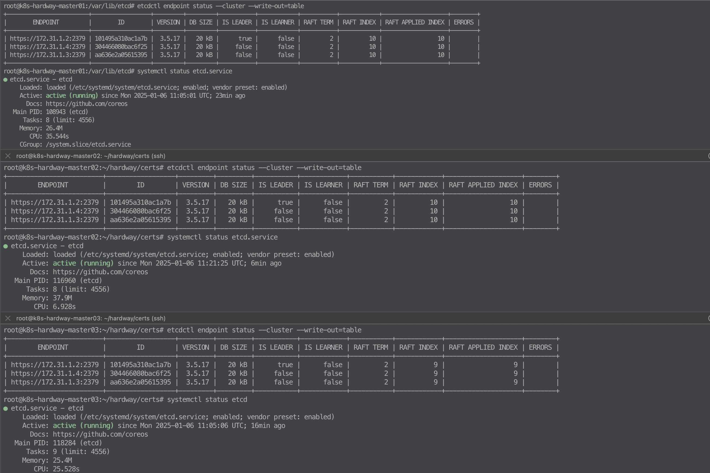

# 07. etcd 클러스터 구성

## etcd 클러스터 생성 (마스터 3대에서 모두 실행)

```bash
# etcd.tar.gz 다운로드 경로 https://github.com/etcd-io/etcd/releases 
# https://mirrors.huaweicloud.com/etcd/v3.5.6/etcd-v3.5.6-linux-amd64.tar.gz 

ubuntu@k8s-hardway-master01:~/hardway/certs# wget https://github.com/etcd-io/etcd/releases/download/v3.5.17/etcd-v3.5.17-linux-amd64.tar.gz
--2025-01-06 10:32:52--  https://github.com/etcd-io/etcd/releases/download/v3.5.17/etcd-v3.5.17-linux-amd64.tar.gz
Resolving github.com (github.com)... 198.51.100.10
Connecting to github.com (github.com)|198.51.100.10|:443... connected.
HTTP request sent, awaiting response... 302 Found
Location: https://objects.githubusercontent.com/...(서명 URL 생략) [following]
--2025-01-06 10:32:52--  https://objects.githubusercontent.com/...(서명 URL 생략)
Resolving objects.githubusercontent.com (objects.githubusercontent.com)... 198.51.100.21, 198.51.100.22, 198.51.100.23, ...
Connecting to objects.githubusercontent.com (objects.githubusercontent.com)|198.51.100.21|:443... connected.
HTTP request sent, awaiting response... 200 OK
Length: 20488380 (20M) [application/octet-stream]
Saving to: ‘etcd-v3.5.17-linux-amd64.tar.gz’

etcd-v3.5.17-linux-amd64.tar.gz   100%[==========================================================>]  19.54M  52.6MB/s    in 0.4s

2025-01-06 10:32:54 (52.6 MB/s) - ‘etcd-v3.5.17-linux-amd64.tar.gz’ saved [20488380/20488380]

root@sj-auth-bastion-192-168-34-226:~/hardway/cert# ll | grep etcd-v3.5.17
-rw-r--r-- 1 root root 20488380 Nov 12 16:36 etcd-v3.5.17-linux-amd64.tar.gz

# etcd 압축 해제 및 권한 부여 및 /etc/ssl/etcd/ssl 경로로 복사
ubuntu@k8s-hardway-master01:~/hardway/certs# {
  tar -xvf etcd-v3.5.17-linux-amd64.tar.gz
  sudo mv etcd-v3.5.17-linux-amd64/etcd* /usr/local/bin/
  sudo mkdir -p /etc/ssl/etcd/ssl /var/lib/etcd  sudo chmod 700 /var/lib/etcd
  sudo cp /home/ubuntu/hardway/certs/ca.crt /home/ubuntu/hardway/certs/etcd-server.key /home/ubuntu/hardway/certs/etcd-server.crt /etc/ssl/etcd/ssl
}

etcd-v3.5.17-linux-amd64/
etcd-v3.5.17-linux-amd64/etcd
etcd-v3.5.17-linux-amd64/etcdctl
etcd-v3.5.17-linux-amd64/etcdutl
etcd-v3.5.17-linux-amd64/README.md
etcd-v3.5.17-linux-amd64/README-etcdctl.md
etcd-v3.5.17-linux-amd64/READMEv2-etcdctl.md
etcd-v3.5.17-linux-amd64/README-etcdutl.md
etcd-v3.5.17-linux-amd64/Documentation/
etcd-v3.5.17-linux-amd64/Documentation/README.md
etcd-v3.5.17-linux-amd64/Documentation/dev-guide/
etcd-v3.5.17-linux-amd64/Documentation/dev-guide/apispec/
etcd-v3.5.17-linux-amd64/Documentation/dev-guide/apispec/swagger/
etcd-v3.5.17-linux-amd64/Documentation/dev-guide/apispec/swagger/rpc.swagger.json
etcd-v3.5.17-linux-amd64/Documentation/dev-guide/apispec/swagger/v3election.swagger.json
etcd-v3.5.17-linux-amd64/Documentation/dev-guide/apispec/swagger/v3lock.swagger.json

# 마스터 노드의 각 인터페이스 확인 할것
ubuntu@k8s-hardway-master01:~/hardway/certs# ip addr show ens34|grep -w "inet"|awk '{print $2}'|cut -d / -f 1
172.31.1.2

# 환경 변수 선언
ubuntu@k8s-hardway-master01:~/hardway/certs# export INTERNAL_IP=$(ip addr show ens33|grep -w "inet"|awk '{print $2}'|cut -d / -f 1 | head -1)
ubuntu@k8s-hardway-master01:~/hardway/certs# export ETCD_NAME=$(hostname -s)
```

---

## systemd etcd service 등록  (마스터 3대에서 모두 실행)

```bash
ubuntu@k8s-hardway-master01:~/hardway/certs# cat <<EOF | sudo tee /etc/systemd/system/etcd.service
[Unit]
Description=etcd
Documentation=https://github.com/coreos
 
[Service]
ExecStart=/usr/local/bin/etcd \\
  --name ${ETCD_NAME} --cert-file=/etc/ssl/etcd/ssl/etcd-server.crt --key-file=/etc/ssl/etcd/ssl/etcd-server.key --peer-cert-file=/etc/ssl/etcd/ssl/etcd-server.crt \\
  --peer-key-file=/etc/ssl/etcd/ssl/etcd-server.key --trusted-ca-file=/etc/ssl/etcd/ssl/ca.crt --peer-trusted-ca-file=/etc/ssl/etcd/ssl/ca.crt --peer-client-cert-auth \\
  --client-cert-auth --initial-advertise-peer-urls https://${INTERNAL_IP}:2380 --listen-peer-urls https://${INTERNAL_IP}:2380 \\
  --listen-client-urls https://${INTERNAL_IP}:2379,https://127.0.0.1:2379 --advertise-client-urls https://${INTERNAL_IP}:2379 \\
  --initial-cluster-token etcd-cluster-0 --initial-cluster-state new --data-dir=/var/lib/etcd \\
 --initial-cluster k8s-hardway-master01=https://172.31.1.2:2380,k8s-hardway-master02=https://172.31.1.3:2380,k8s-hardway-master03=https://172.31.1.4:2380
Restart=on-failure
RestartSec=5
 
[Install]
WantedBy=multi-user.target
EOF
```

---

## etcd 권한 700확인 (마스터 3대에서 모두 실행)

```bash
# etcd 권한 700 확인
ubuntu@k8s-hardway-master01:~/hardway/certs# ls -al /var/lib | grep etcd
drwxr-xr-x  2 root      root      4096 Jan  6 10:56 etcd
ubuntu@k8s-hardway-master01:~/hardway/certs# sudo chmod 700 /var/lib/etcd
ubuntu@k8s-hardway-master01:~/hardway/certs# ls -al /var/lib | grep etcd
drwx------  2 root      root      4096 Jan  6 10:56 etcd
```

---

## etcd service 시작 (마스터 3대에서 모두 실행)

```bash
# etcd service 시작
ubuntu@k8s-hardway-master01:~/hardway/certs# {
   sudo systemctl daemon-reload
   sudo systemctl enable etcd
   sudo systemctl start etcd
}
Created symlink /etc/systemd/system/multi-user.target.wants/etcd.service → /etc/systemd/system/etcd.service.
```



---

## etcd cluster health check (마스터 3대에서 모두 실행)

```bash
ubuntu@k8s-hardway-master01:~/hardway/certs# export ETCDCTL_API=3
ubuntu@k8s-hardway-master01:~/hardway/certs# export ETCDCTL_CERT=/etc/ssl/etcd/ssl/etcd-server.crt
ubuntu@k8s-hardway-master01:~/hardway/certs# export ETCDCTL_KEY=/etc/ssl/etcd/ssl/etcd-server.key
ubuntu@k8s-hardway-master01:~/hardway/certs# export ETCDCTL_CACERT=/etc/ssl/etcd/ssl/ca.crt

root@k8s-hardway-master01:/var/lib/etcd# etcdctl endpoint status --cluster --write-out=table
+-------------------------+------------------+---------+---------+-----------+------------+-----------+------------+--------------------+--------+
|        ENDPOINT         |        ID        | VERSION | DB SIZE | IS LEADER | IS LEARNER | RAFT TERM | RAFT INDEX | RAFT APPLIED INDEX | ERRORS |
+-------------------------+------------------+---------+---------+-----------+------------+-----------+------------+--------------------+--------+
| https://172.31.1.2:2379 | 101495a310ac1a7b |  3.5.17 |   20 kB |      true |      false |         2 |          9 |                  9 |        |
| https://172.31.1.4:2379 | 304466080bac6f25 |  3.5.17 |   20 kB |     false |      false |         2 |          9 |                  9 |        |
| https://172.31.1.3:2379 | aa636e2a05615395 |  3.5.17 |   20 kB |     false |      false |         2 |          9 |                  9 |        |
+-------------------------+------------------+---------+---------+-----------+------------+-----------+------------+--------------------+--------+
```

<details>
<summary>마스터 3곳 출력 결과</summary>



</details>

---

[목차](README.md) · [← 이전](06-distribute-certs.md) · [다음 →](08-control-plane.md)
