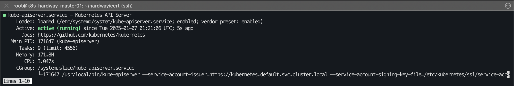
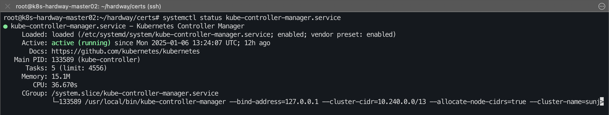

# 08. 컨트롤 플레인 부트스트랩

## bootstrap k8s control plane

- Binary 다운로드 (마스터 노드 3대에서 각각 실행)

```bash
root@k8s-hardway-master01:/home/ubuntu/hardway/certs# wget -q --show-progress --https-only --timestamping \
   https://storage.googleapis.com/kubernetes-release/release/v1.29.7/bin/linux/amd64/kubectl \
   "https://storage.googleapis.com/kubernetes-release/release/v1.29.7/bin/linux/amd64/kube-apiserver" \
   "https://storage.googleapis.com/kubernetes-release/release/v1.29.7/bin/linux/amd64/kube-controller-manager" \
   "https://storage.googleapis.com/kubernetes-release/release/v1.29.7/bin/linux/amd64/kube-scheduler"
  
kubectl                                               100%[=========================================================================================================================>]  47.90M  24.2MB/s    in 2.0s
kube-apiserver                                        100%[=========================================================================================================================>] 118.34M  14.0MB/s    in 7.0s
kube-controller-manager                               100%[=========================================================================================================================>] 113.71M  22.3MB/s    in 5.7s
kube-scheduler                                        100%[=========================================================================================================================>]  53.91M  18.4MB/s    in 2.9s

root@k8s-hardway-master01:/home/ubuntu/hardway/certs# {
   chmod +x kubectl kube-apiserver kube-controller-manager kube-scheduler
   sudo mv kubectl kube-apiserver kube-controller-manager kube-scheduler /usr/local/bin/
 }
```

```bash
root@k8s-hardway-master01:/home/ubuntu/hardway/certs# mkdir -p ~/.kube
root@k8s-hardway-master01:/home/ubuntu/hardway/certs# cp -rf /home/ubuntu/hardway/certs/admin.kubeconfig ~/.kube/config
```

---

- k8s dir를 생성하고 인증서 복사 (마스터 노드 3대에서 각각 실행)

```bash
root@k8s-hardway-master01:/home/ubuntu/hardway/certs# {
    sudo mkdir -p /etc/kubernetes/ssl

    sudo cp /home/ubuntu/hardway/certs/ca.crt /home/ubuntu/hardway/certs/ca.key /home/ubuntu/hardway/certs/kube-apiserver.crt /home/ubuntu/hardway/certs/kube-apiserver.key \
     /home/ubuntu/hardway/certs/service-account.key /home/ubuntu/hardway/certs/service-account.crt /etc/kubernetes/ssl
 }

root@k8s-hardway-master01:/home/ubuntu/hardway/certs# ls /etc/kubernetes/ssl
ca.crt  ca.key  kube-apiserver.crt  kube-apiserver.key  service-account.crt  service-account.key
```

---

- control plane과 admin이 사용할 kubeconfig 복사 (마스터 노드 3대에서 각각 실행)

```bash
root@k8s-hardway-master01:/home/ubuntu/hardway/certs# {
    sudo cp /home/ubuntu/hardway/certs/kube-controller-manager.kubeconfig /etc/kubernetes
    sudo cp /home/ubuntu/hardway/certs/kube-scheduler.kubeconfig /etc/kubernetes
    sudo cp /home/ubuntu/hardway/certs/admin.kubeconfig /etc/kubernetes
 }

# 각 마스터 인터페이스명 확인 할 것

* VIP 로 구성시 
# root@k8s-hardway-master01:/home/ubuntu/hardway/certs# export INTERNAL_IP=172.31.1.8
# root@k8s-hardway-master01:/home/ubuntu/hardway/certs# echo $INTERNAL_IP
172.31.1.8 (VIP)

root@k8s-hardway-master01:/home/ubuntu/hardway/certs# export INTERNAL_IP=$(ip addr show ens34 |grep -w "inet"|awk '{print $2}'|cut -d / -f 1)
root@k8s-hardway-master01:/home/ubuntu/hardway/certs# echo $INTERNAL_IP 
172.31.1.2
 
root@k8s-hardway-master01:/home/ubuntu/hardway/certs# ls /etc/kubernetes/
admin.kubeconfig  kube-controller-manager.kubeconfig  kube-scheduler.kubeconfig  ssl

# PCS 구성할시 아래의 systemd service 등록시 수동으로 VIP 를 박아줘야 됩니다. !!!
```

---

- systemd service 등록 - kube-apiserver (마스터 노드 3대에서 각각 실행)

```bash
root@k8s-hardway-master01:/home/ubuntu/hardway/certs# cat <<EOF | sudo tee /etc/systemd/system/kube-apiserver.service
[Unit]
Description=Kubernetes API Server
Documentation=https://github.com/kubernetes/kubernetes

[Service]
ExecStart=/usr/local/bin/kube-apiserver \
  --service-account-issuer=https://kubernetes.default.svc.cluster.local \
  --service-account-signing-key-file=/etc/kubernetes/ssl/service-account.key \
  --service-account-key-file=/etc/kubernetes/ssl/service-account.pub \
  --advertise-address=${INTERNAL_IP} --allow-privileged=true --apiserver-count=3  --service-cluster-ip-range=10.231.0.0/18 --service-node-port-range=30000-32767 \
  --authorization-mode=Node,RBAC --bind-address=0.0.0.0  --v=2 \
  --client-ca-file=/etc/kubernetes/ssl/ca.crt --enable-admission-plugins=NodeRestriction,ServiceAccount \
  --enable-bootstrap-token-auth=true --etcd-cafile=/etc/ssl/etcd/ssl/ca.crt --etcd-certfile=/etc/ssl/etcd/ssl/etcd-server.crt --etcd-keyfile=/etc/ssl/etcd/ssl/etcd-server.key \
  --etcd-servers=https://172.31.1.2:2379,https://172.31.1.3:2379,https://172.31.1.4:2379 \
  --event-ttl=1h --kubelet-client-certificate=/etc/kubernetes/ssl/kube-apiserver.crt \
  --kubelet-client-key=/etc/kubernetes/ssl/kube-apiserver.key  --runtime-config= --service-account-key-file=/etc/kubernetes/ssl/service-account.crt \
  --tls-cert-file=/etc/kubernetes/ssl/kube-apiserver.crt --tls-private-key-file=/etc/kubernetes/ssl/kube-apiserver.key
Restart=on-failure
RestartSec=5

[Install]
WantedBy=multi-user.target
EOF

 "VIP 구성시 export INTERNAL_IP=172.31.1.8 고정으로 등록합니다."
```

<details>
<summary>상세 설명</summary>

> - `--service-account-issuer=https://kubernetes.default.svc.cluster.local`: 서비스 계정 발급자 URL을 지정합니다.
> - `--service-account-signing-key-file=/etc/kubernetes/ssl/service-account.key`: 서비스 계정 서명 키 파일을 지정합니다.
> - `--advertise-address=${INTERNAL_IP}`: API 서버가 클러스터에 광고할 내부 IP를 지정합니다. `${INTERNAL_IP}`는 실제 IP 주소로 치환되어야 합니다.
> - `--allow-privileged=true`: 권한이 부여된 작업을 허용합니다.
> - `--apiserver-count=3`: API 서버 인스턴스 수를 지정합니다.
> - `--service-cluster-ip-range=10.231.0.0/18`: 클러스터 내 서비스 IP 범위를 설정합니다.
> - `--service-node-port-range=30000-32767`: 노드 포트 범위를 설정합니다.
> - `--authorization-mode=Node,RBAC`: 인증 모드로 Node와 RBAC(Role-Based Access Control)를 설정합니다.
> - `--bind-address=0.0.0.0`: 모든 네트워크 인터페이스에서 바인딩을 허용합니다.
> - `--client-ca-file=/etc/kubernetes/ssl/ca.crt`: 클라이언트 인증서를 검증할 CA 파일을 지정합니다.
> - `--enable-admission-plugins=NodeRestriction,ServiceAccount`: Admission Controller 플러그인 활성화 설정입니다. `NodeRestriction`과 `ServiceAccount` 플러그인을 활성화합니다.
> - `--enable-bootstrap-token-auth=true`: 부트스트랩 토큰 인증을 활성화합니다.
> - `--etcd-cafile=/etc/ssl/etcd/ssl/ca.crt`: etcd 클러스터의 CA 인증서 파일 경로입니다.
> - `--etcd-certfile=/etc/ssl/etcd/ssl/etcd-server.crt`: API 서버와 etcd 간의 통신에 사용할 인증서입니다.
> - `--etcd-keyfile=/etc/ssl/etcd/ssl/etcd-server.key`: etcd 서버 인증서에 대한 비밀 키 파일 경로입니다.
> - `--etcd-servers=https://172.31.1.2:2379,https://172.31.1.3:2379,https://172.31.1.4:2379`: API 서버와 통신할 etcd 서버 목록입니다.
> - `--event-ttl=1h`: 이벤트의 TTL(Time To Live)을 1시간으로 설정합니다.
> - `--kubelet-client-certificate=/etc/kubernetes/ssl/kube-apiserver.crt`: kubelet과의 통신에 사용할 API 서버 인증서 파일입니다.
> - `--kubelet-client-key=/etc/kubernetes/ssl/kube-apiserver.key`: kubelet과의 통신에 사용할 API 서버 키 파일입니다.
> - `--runtime-config=`: 사용할 런타임 설정을 지정할 수 있는 플래그입니다. 여기서는 설정하지 않은 상태입니다.
> - `--service-account-key-file=/etc/kubernetes/ssl/service-account.crt`: 서비스 계정 인증에 사용할 키 파일입니다.
> - `--tls-cert-file=/etc/kubernetes/ssl/kube-apiserver.crt`: TLS 인증서 파일입니다.
> - `--tls-private-key-file=/etc/kubernetes/ssl/kube-apiserver.key`: TLS 비공개 키 파일입니다.

</details>



<details>
<summary>kube-apiserver 에러시</summary>

```bash
# systemctl status kube-apiserver 에러 로그 
systemctl status kube-apiserver.service● kube-apiserver.service - Kubernetes API Server    
Loaded: loaded (/etc/systemd/system/kube-apiserver.service; enabled; vendor preset: enabled)     
Active: activating (auto-restart) (Result: exit-code) since Tue 2025-01-07 01:05:01 UTC; 3s ago       
Docs: https://github.com/kubernetes/kubernetes    
Process: 170402 ExecStart=/usr/local/bin/kube-apiserver --advertise-address=172.31.1.2 --allow-privileged=true --apiserver-count=3 --service-cluster-ip-range=10.231.0.0/18 --service-no>   
Main PID: 170402 (code=exited, status=1/FAILURE)     
CPU: 83msJan 07 01:05:01 k8s-hardway-master01 systemd[1]: kube-apiserver.service: Main process exited, code=exited, status=1/FAILUREJan 07 01:05:01 k8s-hardway-master01 systemd[1]: kube-apiserver.service: Failed with result 'exit-

Jan 07 01:18:04 k8s-hardway-master01 kube-apiserver[171404]: E0107 01:18:04.651513  171404 run.go:74] "command failed" err="[service-account-issuer is a required flag, --service-account-si>
Jan 07 01:18:04 k8s-hardway-master01 systemd[1]: kube-apiserver.service: Main process exited, code=exited, status=1/FAILURE
```

> **Solution**

```bash
# 해결 단계
# kube-apiserver 구성 업데이트: kube-apiserver systemd 서비스 파일(/etc/systemd/system/kube-apiserver.service)의 ExecStart 명령에 필수 플래그를 추가합니다.

# 1. vi /etc/systemd/system/kube-apiserver.service 아래 3줄 추가 
--service-account-issuer=https://kubernetes.default.svc.cluster.local \
--service-account-signing-key-file=/etc/kubernetes/ssl/service-account.key \
--service-account-key-file=/etc/kubernetes/ssl/service-account.pub \

# 2. --서비스 계정 발급자: Kubernetes API 서버의 기본 내부 DNS 이름인 https://kubernetes.default.svc.cluster.local과 같은 값을 사용합니다.
--service-account-signing-key-file: 토큰 서명에 사용되는 개인 키(service-account.key)의 경로를 제공하세요.
--service-account-key-file (선택 사항이지만 권장됨): 개인키에 해당하는 공개키의 경로입니다.
서비스 계정 키 쌍 생성(아직 생성되지 않은 경우): service-account.key 및 service-account.pub가 없으면 생성하세요.

# 3. 아래 service-account.pub 인증서 생성 
openssl genrsa -out /etc/kubernetes/ssl/service-account.key 2048
openssl rsa -in /etc/kubernetes/ssl/service-account.key -pubout -out /etc/kubernetes/ssl/service-account.pub
kube-apiserver 서비스를 다시 시작하세요: systemd 구성을 다시 로드하고 API 서버를 다시 시작합니다.

# 4. systemd 적용
sudo systemctl daemon-reload
sudo systemctl restart kube-apiserver
kube-apiserver 상태 확인: API 서버가 실행 중인지 확인하세요.

# 5. kube-apiserver 상태 확인 
sudo systemctl status kube-apiserver
```

</details>

---

- systemd service 등록 - kube-controller-manager (마스터 노드 3대에서 각각 실행)

```bash
root@k8s-hardway-master01:~/hardway/cert# cat <<EOF | sudo tee /etc/systemd/system/kube-controller-manager.service
[Unit]
Description=Kubernetes Controller Manager
Documentation=https://github.com/kubernetes/kubernetes

[Service]
ExecStart=/usr/local/bin/kube-controller-manager \
  --bind-address=0.0.0.0 --cluster-cidr=10.240.0.0/13 --allocate-node-cidrs=true --cluster-name=sunjae-k8s-hardway \
  --cluster-signing-cert-file=/etc/kubernetes/ssl/ca.crt --cluster-signing-key-file=/etc/kubernetes/ssl/ca.key \
  --kubeconfig=/etc/kubernetes/kube-controller-manager.kubeconfig \
  --leader-elect=true --root-ca-file=/etc/kubernetes/ssl/ca.crt --service-account-private-key-file=/etc/kubernetes/ssl/service-account.key \
  --service-cluster-ip-range=10.231.0.0/18 --use-service-account-credentials=true --v=2
Restart=on-failure
RestartSec=5

[Install]
WantedBy=multi-user.target
EOF
```

<details>
<summary>세부 설명</summary>

> - **`--cluster-cidr=10.240.0.0/13`**: Pod 네트워크에 할당된 CIDR 범위
> - **`--service-cluster-ip-range=10.231.0.0/18`**: 클러스터 내부 서비스에 할당되는 IP 범위입니다.
> - **`--allocate-node-cidrs=true`**: 노드에 CIDR 블록을 자동으로 할당하도록 설정합니다.
> - **`--cluster-name=sunjae-k8s-hardway`**: 클러스터 이름을 지정합니다.
> - **`--cluster-signing-cert-file=/etc/kubernetes/ssl/ca.crt`** : CSR 서명을 위한 CA 인증서 경로입니다.
> - **`--cluster-signing-key-file=/etc/kubernetes/ssl/ca.key`**: CSR 서명을 위한 CA 키 경로입니다.
> - **`--service-account-private-key-file=/etc/kubernetes/ssl/service-account.key`**: Service Account 토큰을 서명하는 데 사용되는 개인 키입니다.

</details>

---



---

- systemd service 등록 - kube-scheduler (마스터 노드 3대에서 각각 실행)

```bash
root@k8s-hardway-master01:~/hardway/cert# cat <<EOF | sudo tee /etc/systemd/system/kube-scheduler.service
[Unit]
Description=Kubernetes Scheduler
Documentation=https://github.com/kubernetes/kubernetes

[Service]
ExecStart=/usr/local/bin/kube-scheduler \
  --kubeconfig=/etc/kubernetes/kube-scheduler.kubeconfig \
  --bind-address=127.0.0.1 \
  --leader-elect=true \
  --v=2
Restart=on-failure
RestartSec=5

[Install]
WantedBy=multi-user.target
EOF
```

<details>
<summary>세부 설명</summary>

> - **`--v=2`**: 로그 수준을 설정합니다.
> - **`--leader-elect=true`**: 리더 선출 기능을 활성화합니다.→ 다중 Scheduler 실행 시 하나만 활성 상태가 되어 고가용성을 보장합니다.
> - **`--address=127.0.0.1`**: Scheduler가 요청을 수신할 로컬 주소를 설정합니다.→ 외부 접근이 불필요한 Scheduler의 보안을 강화하기 위해 *`127.0.0.1`*로 제한합니다.
> - **`--kubeconfig=/etc/kubernetes/kube-scheduler.kubeconfig`**: Scheduler가 API 서버와 통신하는 데 사용하는 `kubeconfig` 파일입니다.→ API 서버에 접근하기 위한 자격 증명 및 연결 설정을 포함합니다.
> - **`/usr/local/bin/kube-scheduler`**: Kubernetes Scheduler 바이너리를 실행합니다.

</details>

---


- systemd service 시작 (마스터 노드 3대에서 각각 실행)

```bash
root@k8s-hardway-master01:/home/ubuntu/hardway/certs# {
   sudo systemctl daemon-reload
   sudo systemctl enable kube-apiserver kube-controller-manager kube-scheduler
   sudo systemctl start kube-apiserver kube-controller-manager kube-scheduler
   sudo systemctl status kube-apiserver kube-controller-manager kube-scheduler
 }
Created symlink /etc/systemd/system/multi-user.target.wants/kube-apiserver.service → /etc/systemd/system/kube-apiserver.service.
Created symlink /etc/systemd/system/multi-user.target.wants/kube-controller-manager.service → /etc/systemd/system/kube-controller-manager.service.
Created symlink /etc/systemd/system/multi-user.target.wants/kube-scheduler.service → /etc/systemd/system/kube-scheduler.service.
```

---

- kubectl 명령어 실행 (마스터 노드 3대에서 각각 실행)

```bash
root@k8s-hardway-master01:~/hardway/cert# kubectl get nodes
No resources found

root@k8s-hardway-master01:~/hardway/cert# kubectl version
Client Version: v1.29.7
Server Version: v1.29.7
Kustomize Version: v5.0.4-0.20230601165947-6ce0bf390ce3

root@k8s-hardway-master01:~/hardway/cert# kubectl get svc
NAME         TYPE        CLUSTER-IP   EXTERNAL-IP   PORT(S)   AGE
kubernetes   ClusterIP   10.231.0.1   <none>        443/TCP   3h33m
```

---

```bash
# API Server Self 통신 테스트
root@k8s-hardway-master01:~/hardway/cert# curl https://localhost:6443/version -k
{
  "major": "1",
  "minor": "29",
  "gitVersion": "v1.29.7",
  "gitCommit": "4e4a18878ce330fefda1dc46acca88ba355e9ce7",
  "gitTreeState": "clean",
  "buildDate": "2024-07-16T23:57:48Z",
  "goVersion": "go1.22.5",
  "compiler": "gc",
  "platform": "linux/amd64"
  }
```

---

[목차](README.md) · [← 이전](07-etcd.md) · [다음 →](09-worker01.md)
