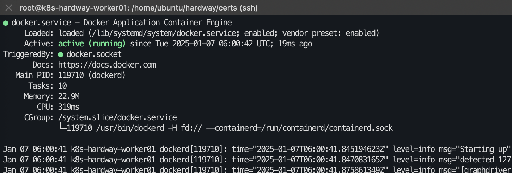
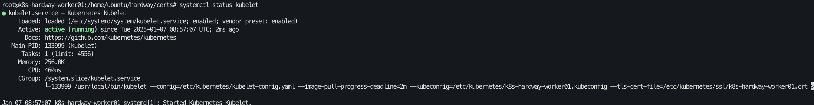
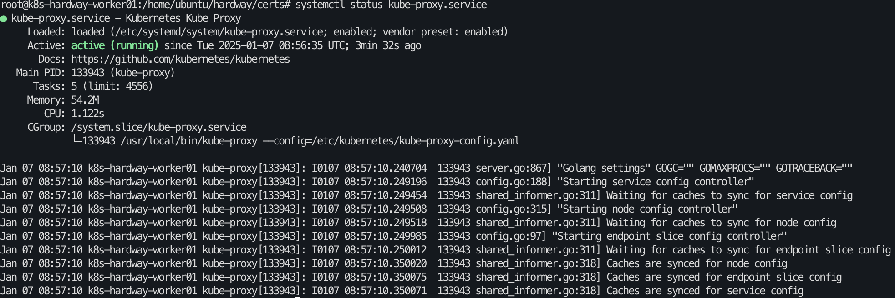
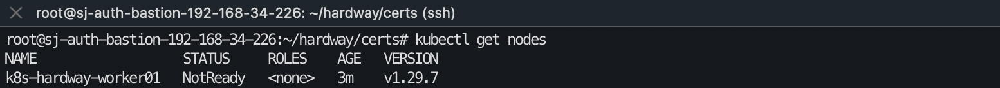

# 09. Worker01 구성 (수동 인증서)

## kubelet client 인증서 생성 (auth-bastion 에서 진행합니다. )

> - IP.1 = 172.31.1.5
> - worker node 1의 ip 주소

<details>
<summary>openssl-k8s-hardway-worker01.cnf 인증서 생성 (워커01만 생성하면 됨)</summary>

```bash
root@k8s-hardway-bastion:~/hardway/cert# cat > openssl-k8s-hardway-worker01.cnf <<EOF
[req]
req_extensions = v3_req
distinguished_name = req_distinguished_name

[req_distinguished_name]

[ v3_req ]
basicConstraints = CA:FALSE
keyUsage = nonRepudiation, digitalSignature, keyEncipherment
subjectAltName = @alt_names

[alt_names] 
IP.1 = 172.31.1.5  # worker01번 IP 
DNS.1 = k8s-hardway-worker01
EOF

root@sj-auth-bastion-192-168-34-226:~/hardway/certs# openssl genrsa -out k8s-hardway-worker01.key 2048
root@sj-auth-bastion-192-168-34-226:~/hardway/certs# openssl req -new -key k8s-hardway-worker01.key -subj "/CN=system:node:k8s-hardway-worker01/O=system:nodes" -out k8s-hardway-worker01.csr -config openssl-k8s-hardway-worker01.cnf
root@sj-auth-bastion-192-168-34-226:~/hardway/certs# openssl x509 -req -in k8s-hardway-worker01.csr -CA ca.crt -CAkey ca.key -CAcreateserial  -out k8s-hardway-worker01.crt -extensions v3_req -extfile openssl-k8s-hardway-worker01.cnf -days 365
Certificate request self-signature ok
subject=CN = system:node:k8s-hardway-worker01, O = system:nodes
Getting CA Private Key

root@sj-auth-bastion-192-168-34-226:~/hardway/certs# ls | grep worker01
k8s-hardway-worker01.csr
k8s-hardway-worker01.key
openssl-k8s-hardway-worker01.cnf
```

</details>

---

## kubelet kubeconfig 생성 (bastion 인스턴스에서 진행합니다. )

> - export KUBE_API_SERVER_ADDRESS=172.31.1.2 ( or VIP : 172.31.1.8 )
> - master node 1의 ip 주소 ( or VIP : 172.31.1.8 )

```bash
root@sj-auth-bastion-192-168-34-226:~/hardway/certs# export KUBE_API_SERVER_ADDRESS=172.31.1.2  / export KUBE_API_SERVER_ADDRESS=172.31.1.8 
root@sj-auth-bastion-192-168-34-226:~/hardway/certs# {
   kubectl config set-cluster sunjae-k8s-hardway \
     --certificate-authority=ca.crt --embed-certs=true \
     --server=https://${KUBE_API_SERVER_ADDRESS}:6443 --kubeconfig=k8s-hardway-worker01.kubeconfig
  
   kubectl config set-credentials system:node:k8s-hardway-worker01 \
     --client-certificate=k8s-hardway-worker01.crt --client-key=k8s-hardway-worker01.key \
     --embed-certs=true --kubeconfig=k8s-hardway-worker01.kubeconfig
  
   kubectl config set-context default \
     --cluster=sunjae-k8s-hardway --user=system:node:k8s-hardway-worker01 --kubeconfig=k8s-hardway-worker01.kubeconfig
  
   kubectl config use-context default --kubeconfig=k8s-hardway-worker01.kubeconfig
 }
 
Cluster "sunjae-k8s-hardway" set.
User "system:node:k8s-hardway-worker01" set.
Context "default" created.
Switched to context "default".
```

---

- kubelet server/client cert/key 배포
  - worker01에게 인증서 전송

```bash
root@sj-auth-bastion-192-168-34-226:~/hardway/certs# for instance in 172.31.1.5; do
   scp -i sunjae.pem k8s-hardway-worker01.crt k8s-hardway-worker01.key k8s-hardway-worker01.kubeconfig ubuntu@${instance}:/home/ubuntu/hardway/certs
 done
 
ubuntu@172.31.1.5's password:
k8s-hardway-worker01.crt                                                                 100% 1285     2.0MB/s   00:00
k8s-hardway-worker01.key                                                                 100% 1704     3.3MB/s   00:00
k8s-hardway-worker01.kubeconfig                                                          100% 7173     7.4MB/s   00:00                                                                                               100% 5561     7.9MB/s   00:00    
```

---

## docker 설치

- docker 설치 (worker01)

```bash
sudo apt-get update
sudo apt-get install -y docker.io
sudo swapoff -a
```

---

- Docker 서비스 시작 및 테스트 (worker01)



```bash
root@k8s-hardway-worker01:/home/ubuntu/hardway/certs# {
 sudo systemctl daemon-reload
 sudo systemctl enable docker
 sudo systemctl restart docker
 sudo systemctl status docker
}

root@k8s-hardway-worker01:/home/ubuntu/hardway/certs# sudo docker run --rm -it nicolaka/netshoot
Unable to find image 'nicolaka/netshoot:latest' locally
latest: Pulling from nicolaka/netshoot
4abcf2066143: Pull complete
f72249ed6705: Pull complete
d21093198226: Pull complete
ff793c57efef: Pull complete
b8cdfec6d24e: Pull complete
b6621d484422: Pull complete
452eb7889eb5: Pull complete
4f4fb700ef54: Pull complete
89065cf5c037: Pull complete
a4b421d4901a: Pull complete
d5c3ad7ea15a: Pull complete
ab073295bbd0: Pull complete
737c1bf9f2ef: Pull complete
097ac21093f8: Pull complete
59e353e0ee74: Pull complete
Digest: sha256:a20c2531bf35436ed3766cd6cfe89d352b050ccc4d7005ce6400adf97503da1b
Status: Downloaded newer image for nicolaka/netshoot:latest
                    dP            dP                           dP
                    88            88                           88
88d888b. .d8888b. d8888P .d8888b. 88d888b. .d8888b. .d8888b. d8888P
88'  `88 88ooood8   88   Y8ooooo. 88'  `88 88'  `88 88'  `88   88
88    88 88.  ...   88         88 88    88 88.  .88 88.  .88   88
dP    dP `88888P'   dP   `88888P' dP    dP `88888P' `88888P'   dP

Welcome to Netshoot! (github.com/nicolaka/netshoot)
Version: 0.13

b631cbd6bf4c  ~ 
```

---

## Binary 다운로드

- kubectl, kube-proxy, kubelet (worker01)

```bash
# 워커노드의 kubectl, kube-proxy, kubelet 바이너리 설치
root@k8s-hardway-worker01:# wget -q --show-progress --https-only --timestamping \
  https://storage.googleapis.com/kubernetes-release/release/v1.29.7/bin/linux/amd64/kubectl \
  https://storage.googleapis.com/kubernetes-release/release/v1.29.7/bin/linux/amd64/kube-proxy \
  https://storage.googleapis.com/kubernetes-release/release/v1.29.7/bin/linux/amd64/kubelet

kubectl                                       100%[===============================================================================================>]  47.90M  27.0MB/s    in 1.8s
kube-proxy                                    100%[===============================================================================================>]  53.25M  21.8MB/s    in 2.4s
kubelet                                       100%[===============================================================================================>] 107.36M  31.5MB/s    in 4.1s
--2025-01-07 08:19:27--  https://github.com/containernetworking/plugins/releases/download/v1.6.2/cni-plugins-linux-amd64-v1.6.2.tgz
Resolving github.com (github.com)... 198.51.100.10
Connecting to github.com (github.com)|198.51.100.10|:443... connected.
HTTP request sent, awaiting response... 302 Found
Location: https://objects.githubusercontent.com/...(서명 URL 생략) [following]
--2025-01-07 08:19:27--  https://objects.githubusercontent.com/...(서명 URL 생략)
Resolving objects.githubusercontent.com (objects.githubusercontent.com)... 198.51.100.24, 198.51.100.22, 198.51.100.21, ...
Connecting to objects.githubusercontent.com (objects.githubusercontent.com)|198.51.100.24|:443... connected.
HTTP request sent, awaiting response... 200 OK
Length: 52794236 (50M) [application/octet-stream]
Saving to: ‘cni-plugins-linux-amd64-v1.6.2.tgz’

cni-plugins-linux-amd64-v1.6.2.tgz            100%[===============================================================================================>]  50.35M  32.7MB/s    in 1.5s

2025-01-07 08:19:30 (32.7 MB/s) - ‘cni-plugins-linux-amd64-v1.6.2.tgz’ saved [52794236/52794236]

root@k8s-hardway-worker01:# sudo mkdir -p /etc/cni/net.d /opt/cni/bin /var/lib/kubelet /var/lib/kube-proxy /etc/kubernetes/ssl /var/run/kubernetes

# kubectl, kube-proxy, kubelet 파일 /usr/local/bin 으로 전송
root@k8s-hardway-worker01:# {
  chmod +x kubectl kube-proxy kubelet
  sudo mv kubectl kube-proxy kubelet /usr/local/bin/
}

# CNI Plugin 설치 후  /opt/cni/bin/ 으로 압축 풀기
root@k8s-hardway-worker01:# {
  sudo mkdir -p /opt/cni/bin
  wget https://github.com/containernetworking/plugins/releases/download/v1.6.2/cni-plugins-linux-amd64-v1.6.2.tgz
  sudo tar -xzvf cni-plugins-linux-amd64-v1.6.2.tgz --directory /opt/cni/bin/
}
```

---

- 인증서 옮기기 ( worker01 )

```bash
root@k8s-hardway-worker01:/home/ubuntu/hardway/certs# export HOSTNAME=$(hostname)
root@k8s-hardway-worker01:/home/ubuntu/hardway/certs# {
   mkdir -p /etc/kubernetes/ssl
   sudo cp -rf /home/ubuntu/hardway/certs/${HOSTNAME}.key /home/ubuntu/hardway/certs/${HOSTNAME}.crt /home/ubuntu/hardway/certs/ca.crt /etc/kubernetes/ssl
   sudo cp -rf /home/ubuntu/hardway/certs/${HOSTNAME}.kubeconfig /etc/kubernetes
}
```

---

- kubelet-config.yaml ( worker01 )

```bash
root@k8s-hardway-worker01:/home/ubuntu/hardway/certs# cat << EOF | sudo tee /etc/kubernetes/kubelet-config.yaml
kind: KubeletConfiguration
apiVersion: kubelet.config.k8s.io/v1beta1
authentication:
  anonymous:
    enabled: false
  webhook:
    enabled: true
  x509:
    clientCAFile: "/etc/kubernetes/ssl/ca.crt"
authorization:
  mode: Webhook
clusterDomain: "cluster.local"
clusterDNS:
- 10.231.0.10
resolvConf: "/run/systemd/resolve/resolv.conf"
runtimeRequestTimeout: "15m"
EOF
```

<details>
<summary>세부 설명</summary>

> - **`anonymous: enabled: false`**
>   → 익명 사용자의 Kubelet 접근을 비활성화합니다.
>
>   → 인증되지 않은 접근을 차단하여 보안을 강화합니다.
> - **`webhook: enabled: true`**
>   → Kubelet이 인증 요청을 Kubernetes API 서버의 Webhook으로 전달해 인증 절차를 처리합니다.
> - **`x509: clientCAFile: "/etc/kubernetes/ssl/ca.crt"`**
>   → 클라이언트 인증서를 검증할 때 사용하는 CA 인증서 경로를 지정합니다.
>
>   → "/etc/kubernetes/ssl/ca.crt" 파일은 Kubelet이 신뢰할 수 있는 인증서를 정의합니다.
> - **`clusterDomain: "cluster.local"`**
>   → Kubernetes 클러스터의 기본 DNS 도메인 이름입니다.
>
>   → 클러스터 내에서 서비스 이름을 DNS로 검색할 때 사용됩니다.
> - **`clusterDNS: - 10.231.0.10`**
>   → 클러스터 내의 Pod가 사용할 DNS 서버의 IP 주소를 지정합니다.
>
>   → 일반적으로 CoreDNS 또는 kube-dns가 제공하는 DNS 서비스의 IP입니다.
> - **`resolvConf: "/run/systemd/resolve/resolv.conf"`**
>   → Kubelet이 사용하는 DNS 설정 파일의 경로입니다.

</details>

---

- kubelet.service

```bash
root@k8s-hardway-worker01:/home/ubuntu/hardway/certs# cat <<EOF | sudo tee /etc/systemd/system/kubelet.service
[Unit]
Description=Kubernetes Kubelet
Documentation=https://github.com/kubernetes/kubernetes
After=docker.service
Requires=docker.service

[Service]
ExecStart=/usr/local/bin/kubelet \
  --config=/etc/kubernetes/kubelet-config.yaml  \
  --kubeconfig=/etc/kubernetes/k8s-hardway-worker01.kubeconfig --tls-cert-file=/etc/kubernetes/ssl/k8s-hardway-worker01.crt \
  --tls-private-key-file=/etc/kubernetes/ssl/k8s-hardway-worker01.key --register-node=true --v=2
Restart=on-failure
RestartSec=5

[Install]
WantedBy=multi-user.target
EOF

```

---

```bash
root@k8s-hardway-worker01:/home/ubuntu/hardway/certs# {
   sudo cp /home/ubuntu/hardway/certs/kube-proxy.kubeconfig /etc/kubernetes
 }

root@k8s-hardway-worker01:/home/ubuntu/hardway/certs# ls /etc/kubernetes/
k8s-hardway-worker01.kubeconfig  kubelet-config.yaml  kube-proxy.kubeconfig  ssl
```

---

```bash
root@k8s-hardway-worker01:/home/ubuntu/hardway/certs# sudo apt-get install ipset -y
```

---

```bash

root@k8s-hardway-worker01:/home/ubuntu/hardway/certs# cat <<EOF | sudo tee /etc/kubernetes/kube-proxy-config.yaml
kind: KubeProxyConfiguration
apiVersion: kubeproxy.config.k8s.io/v1alpha1
clientConnection:
  kubeconfig: "/etc/kubernetes/kube-proxy.kubeconfig"
mode: "ipvs"
clusterCIDR: "10.240.0.0/13"
EOF
```

---

```bash
root@k8s-hardway-worker01:/home/ubuntu/hardway/certs#  cat <<EOF | sudo tee /etc/systemd/system/kube-proxy.service
[Unit]
Description=Kubernetes Kube Proxy
Documentation=https://github.com/kubernetes/kubernetes
 
[Service]
ExecStart=/usr/local/bin/kube-proxy \\
  --config=/etc/kubernetes/kube-proxy-config.yaml
  Restart=on-failure
RestartSec=5

[Install]
WantedBy=multi-user.target
EOF
```

---

```bash
root@k8s-hardway-worker01:/home/ubuntu/hardway/certs# {
  sudo systemctl daemon-reload
  sudo systemctl enable kubelet kube-proxy
  sudo systemctl start kubelet kube-proxy
}

root@k8s-hardway-worker01:/home/ubuntu/hardway/certs# systemctl status kubelet
root@k8s-hardway-worker01:/home/ubuntu/hardway/certs# systemctl status kube-proxy
root@k8s-hardway-worker01:/home/ubuntu/hardway/certs# sudo journalctl -xef -u kubelet
root@k8s-hardway-worker01:/home/ubuntu/hardway/certs# sudo journalctl -xef -u kube-proxy
```

- kubelet 상태 확인



- kube-proxy 상태 확인



---

- auth-bastion에서 worker 노드 확인
  - overlay network가 없기 때문에 NotReady 상태이다.

```bash
root@sj-auth-bastion-192-168-34-226:~/hardway/certs# kubectl get nodes
NAME                   STATUS     ROLES    AGE   VERSION
k8s-hardway-worker01   NotReady   <none>   18s   v1.29.7
```



<details>
<summary>에러 로그시</summary>

```bash
E0108 08:40:06.616484   58244 memcache.go:265] couldn't get current server API group list: Get "http://localhost:8080/api?timeout=32s": dial tcp 127.0.0.1:8080: connect: connection refused
The connection to the server localhost:8080 was refused - did you specify the right host or port?
```

```bash
sudo systemctl enable cri-dockerd.service
sudo systemctl restart cri-dockerd.service 
sudo systemctl start kubelet

kubectl cluster-info
# Kubernetes control plane is running at https://127.0.0.1:6443
```

</details>

---

[목차](README.md) · [← 이전](08-control-plane.md) · [다음 →](10-cilium-coredns.md)
