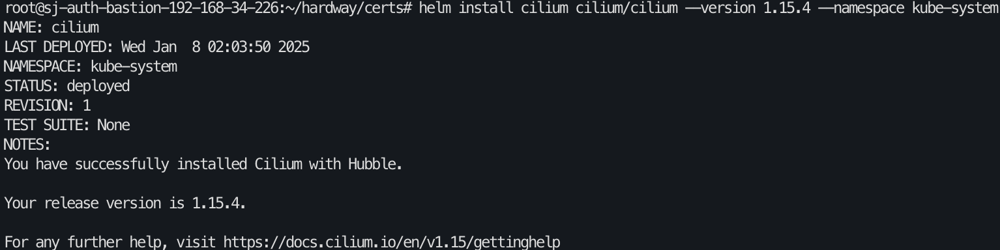
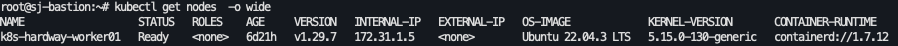

# 10. Cilium CNI, RBAC, CoreDNS

## auth-bastion 에서 Helm Chart를 활용한 CNI Plugin 설치

```bash
## 릴리즈 파일 : https://github.com/containernetworking/plugins/releases

root@sj-auth-bastion-192-168-34-226:~/hardway/certs# mkdir helm

root@sj-auth-bastion-192-168-34-226:~/hardway/certs# wget https://get.helm.sh/helm-v3.9.4-linux-amd64.tar.gz
root@sj-auth-bastion-192-168-34-226:~/hardway/certs# tar xvfz helm-v3.9.4-linux-amd64.tar.gz 
linux-amd64/
linux-amd64/helm
linux-amd64/LICENSE
linux-amd64/README.md

root@sj-auth-bastion-192-168-34-226:~/hardway/certs# ls
helm-v3.9.4-linux-amd64.tar.gz  linux-amd64

root@sj-auth-bastion-192-168-34-226:~/hardway/certs# mv linux-amd64/helm /usr/bin/

root@sj-auth-bastion-192-168-34-226:~/hardway/certs# helm list
NAME	NAMESPACE	REVISION	UPDATED	STATUS	CHART	APP VERSION

root@sj-auth-bastion-192-168-34-226:~/hardway/certs# helm repo add cilium https://helm.cilium.io/
"cilium" has been added to your repositories

root@sj-auth-bastion-192-168-34-226:~/hardway/certs# helm repo update

root@sj-auth-bastion-192-168-34-226:~/hardway/certs# helm install cilium cilium/cilium --version 1.15.4 --namespace kube-system
NAME: cilium
LAST DEPLOYED: Wed Jan  8 02:03:50 2025
NAMESPACE: kube-system
STATUS: deployed
REVISION: 1
TEST SUITE: None
NOTES:
You have successfully installed Cilium with Hubble.

Your release version is 1.15.4.

For any further help, visit https://docs.cilium.io/en/v1.15/gettinghelp
root@sj-auth-bastion-192-168-34-226:~/hardway/certs# helm list -A
NAME  	NAMESPACE  	REVISION	UPDATED                                	STATUS  	CHART        	APP VERSION
cilium	kube-system	1       	2025-01-08 02:03:50.939983091 +0000 UTC	deployed	cilium-1.15.4	1.15.4
```



---

## 로그 권한을 위한 Clusterrole, Clusterrolebinding

- clusterrolebinding.yaml

```bash

root@sj-auth-bastion-192-168-34-226:~/hardway/certs# cat << EOF > kubelet-clusterrolebinding.yaml
apiVersion: rbac.authorization.k8s.io/v1
kind: ClusterRoleBinding
metadata:
  name: system:kube-apiserver
roleRef:
  apiGroup: rbac.authorization.k8s.io
  kind: ClusterRole
  name: system:kube-apiserver-to-kubelet
subjects:
  - kind: User
    name: kube-apiserver
    apiGroup: rbac.authorization.k8s.io
EOF

root@sj-auth-bastion-192-168-34-226:~/hardway/certs# kubectl create -f kubelet-clusterrolebinding.yaml

root@sj-auth-bastion-192-168-34-226:~/hardway/certs# kubectl get clusterrolebinding system:kube-apiserver
NAME                    ROLE                                           AGE
system:kube-apiserver   ClusterRole/system:kube-apiserver-to-kubelet   10s

root@sj-auth-bastion-192-168-34-226:~/hardway/certs# kubectl describe clusterrolebinding system:kube-apiserver
Name:         system:kube-apiserver
Labels:       <none>
Annotations:  <none>
Role:
  Kind:  ClusterRole
  Name:  system:kube-apiserver-to-kubelet
Subjects:
  Kind  Name            Namespace
  ----  ----            ---------
  User  kube-apiserver
```

- clusterrole.yaml

```bash
root@sj-auth-bastion-192-168-34-226:~/hardway/certs# cat << EOF > kubelet-clusterrole.yaml
apiVersion: rbac.authorization.k8s.io/v1
kind: ClusterRole
metadata:
  name: system:kube-apiserver-to-kubelet
  annotations:
    rbac.authorization.kubernetes.io/autoupdate: "true"
  labels:
    kubernetes.io/bootstrapping: rbac-defaults
rules:
  - apiGroups:
      - ""
    resources:
      - nodes/proxy
      - nodes/stats
      - nodes/log
      - nodes/spec
      - nodes/metrics
    verbs:
      - "*"
EOF

root@sj-auth-bastion-192-168-34-226:~/hardway/certs# kubectl create -f kubelet-clusterrole.yaml
clusterrole.rbac.authorization.k8s.io/system:kube-apiserver-to-kubelet created

root@sj-auth-bastion-192-168-34-226:~/hardway/certs# kubectl get clusterrole system:kube-apiserver-to-kubelet
NAME                               CREATED AT
system:kube-apiserver-to-kubelet   2025-01-07T11:27:26Z

root@sj-auth-bastion-192-168-34-226:~/hardway/certs# kubectl api-resources | grep -i rbac
clusterrolebindings                            rbac.authorization.k8s.io/v1      false        ClusterRoleBinding
clusterroles                                   rbac.authorization.k8s.io/v1      false        ClusterRole
rolebindings                                   rbac.authorization.k8s.io/v1      true         RoleBinding
roles                                          rbac.authorization.k8s.io/v1      true         Role

```

---

- Ready 상태 확인



---

- 로그 확인

```bash
root@sj-auth-bastion-192-168-34-226:~/hardway/certs# kubectl logs -f cilium-glprq -n kube-system
```

---

## CoreDNS

```bash

---
root@sj-auth-bastion-192-168-34-226:~/hardway/certs# vi coredns.yaml
apiVersion: v1
kind: ConfigMap
metadata:
  name: coredns
  namespace: kube-system
  labels:
      addonmanager.kubernetes.io/mode: EnsureExists
data:
  Corefile: |
    .:53 {
        errors
        health {
            lameduck 5s
        }
        ready
        kubernetes cluster.local in-addr.arpa ip6.arpa {
          pods insecure
          fallthrough in-addr.arpa ip6.arpa
        }
        prometheus :9153
        forward . /etc/resolv.conf {
          prefer_udp
        }
        cache 30
        loop
        reload
        loadbalance
    }
---
apiVersion: rbac.authorization.k8s.io/v1
kind: ClusterRoleBinding
metadata:
  annotations:
    rbac.authorization.kubernetes.io/autoupdate: "true"
  labels:
    kubernetes.io/bootstrapping: rbac-defaults
    addonmanager.kubernetes.io/mode: EnsureExists
  name: system:coredns
roleRef:
  apiGroup: rbac.authorization.k8s.io
  kind: ClusterRole
  name: system:coredns
subjects:
  - kind: ServiceAccount
    name: coredns
    namespace: kube-system
---
apiVersion: rbac.authorization.k8s.io/v1
kind: ClusterRole
metadata:
  labels:
    kubernetes.io/bootstrapping: rbac-defaults
    addonmanager.kubernetes.io/mode: Reconcile
  name: system:coredns
rules:
  - apiGroups:
      - ""
    resources:
      - endpoints
      - services
      - pods
      - namespaces
    verbs:
      - list
      - watch
  - apiGroups:
      - ""
    resources:
      - nodes
    verbs:
      - get
---
apiVersion: apps/v1
kind: Deployment
metadata:
  name: "coredns"
  namespace: kube-system
  labels:
    k8s-app: "kube-dns"
    addonmanager.kubernetes.io/mode: Reconcile
    kubernetes.io/name: "coredns"
spec:
  strategy:
    type: RollingUpdate
    rollingUpdate:
      maxUnavailable: 0
      maxSurge: 10%
  selector:
    matchLabels:
      k8s-app: kube-dns
  template:
    metadata:
      labels:
        k8s-app: kube-dns
    spec:
      priorityClassName: system-cluster-critical
      nodeSelector:
        kubernetes.io/os: linux
      serviceAccountName: coredns
      tolerations:
        - key: node-role.kubernetes.io/master
          effect: NoSchedule
        - key: "CriticalAddonsOnly"
          operator: "Exists"
      affinity:
        podAntiAffinity:
          requiredDuringSchedulingIgnoredDuringExecution:
          - topologyKey: "kubernetes.io/hostname"
            labelSelector:
              matchLabels:
                k8s-app: kube-dns
        nodeAffinity:
          preferredDuringSchedulingIgnoredDuringExecution:
          - weight: 100
            preference:
              matchExpressions:
              - key: node-role.kubernetes.io/master
                operator: In
                values:
                - ""
      securityContext:
        seccompProfile:
          type: RuntimeDefault
      containers:
      - name: coredns
        image: "coredns/coredns:1.6.5"
        imagePullPolicy: IfNotPresent
        resources:
          # TODO: Set memory limits when we've profiled the container for large
          # clusters, then set request = limit to keep this container in
          # guaranteed class. Currently, this container falls into the
          # "burstable" category so the kubelet doesn't backoff from restarting it.
          limits:
            memory: 170Mi
          requests:
            cpu: 100m
            memory: 70Mi
        args: [ "-conf", "/etc/coredns/Corefile" ]
        volumeMounts:
        - name: config-volume
          mountPath: /etc/coredns
        - name: tz-config
          mountPath: /etc/localtime
          readOnly: true
        ports:
        - containerPort: 53
          name: dns
          protocol: UDP
        - containerPort: 53
          name: dns-tcp
          protocol: TCP
        - containerPort: 9153
          name: metrics
          protocol: TCP
        securityContext:
          allowPrivilegeEscalation: false
          capabilities:
            add:
            - NET_BIND_SERVICE
            drop:
            - all
          readOnlyRootFilesystem: true
        livenessProbe:
          httpGet:
            path: /health
            port: 8080
            scheme: HTTP
          timeoutSeconds: 5
          successThreshold: 1
          failureThreshold: 10
        readinessProbe:
          httpGet:
            path: /ready
            port: 8181
            scheme: HTTP
          timeoutSeconds: 5
          successThreshold: 1
          failureThreshold: 10
      dnsPolicy: Default
      volumes:
        - name: config-volume
          configMap:
            name: coredns
            items:
            - key: Corefile
              path: Corefile
        - name: tz-config
          hostPath:
            path: /etc/localtime
---
apiVersion: v1
kind: ServiceAccount
metadata:
  name: coredns
  namespace: kube-system
  labels:
    addonmanager.kubernetes.io/mode: Reconcile
---
apiVersion: v1
kind: Service
metadata:
  name: coredns
  namespace: kube-system
  labels:
    k8s-app: kube-dns
    kubernetes.io/name: "coredns"
    addonmanager.kubernetes.io/mode: Reconcile
  annotations:
    prometheus.io/port: "9153"
    prometheus.io/scrape: "true"
spec:
  selector:
    k8s-app: kube-dns
  clusterIP: 10.231.0.10
  ports:
    - name: dns
      port: 53
      protocol: UDP
    - name: dns-tcp
      port: 53
      protocol: TCP
    - name: metrics
      port: 9153
      protocol: TCP
      
# coredns.yaml 파일 배포
root@sj-auth-bastion-192-168-34-226:~/hardway/certs# kubectl create -f coredns.yaml 
```

- **`clusterIP: 10.231.0.10`**: CoreDNS 서비스의 클러스터 IP입니다.

---

[목차](README.md) · [← 이전](09-worker01.md) · [다음 →](11-network-test.md)
