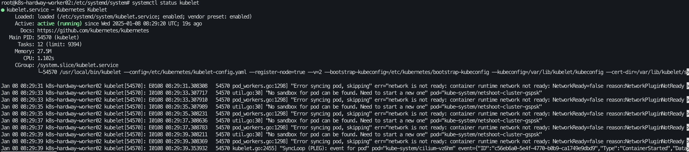
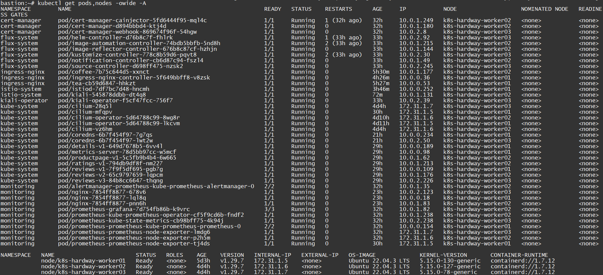

# 12. TLS Bootstrapping으로 Worker02·03 조인

## TLS Bootstrapping Token 생성 (Bastion)

> [!NOTE]
> 공개 문서이므로 토큰 값은 `CHANGE_ME_TOKEN_ID` / `CHANGE_ME_BOOTSTRAP_TOKEN_SECRET` 자리표시자로 바꿨습니다. 실제로는 `[a-z0-9]{6}.[a-z0-9]{16}` 형식 값(예: `kubeadm token generate`)을 만들어 아래 Secret과 bootstrap-kubeconfig에 같은 값으로 넣습니다.

> **부트스트랩 토큰 구성의 역할**
>
> - 부트스트랩 토큰은 Kubernetes API 서버와 새 노드 간의 초기 인증을 지원합니다.
> - YAML 파일에서 생성한 토큰(`token-id`와 `token-secret`)은 노드가 클러스터에 가입할 때 사용됩니다.

```bash
root@sj-auth-bastion-192-168-34-226:~/hardway/certs# cat > bootstrap-token-CHANGE_ME_TOKEN_ID.yaml <<EOF
 apiVersion: v1
 kind: Secret
 metadata:
   # Name MUST be of form "bootstrap-token-<token id>"
   name: bootstrap-token-CHANGE_ME_TOKEN_ID
   namespace: kube-system
  
 # Type MUST be 'bootstrap.kubernetes.io/token'
 type: bootstrap.kubernetes.io/token
 stringData:
   # Human readable description. Optional.
   description: "The bootstrap token generated by kdt kakao"
  
   # Token ID and secret. Required.
   token-id: CHANGE_ME_TOKEN_ID
   token-secret: CHANGE_ME_BOOTSTRAP_TOKEN_SECRET
  
   # Expiration. Optional.
   expiration: 2121-09-01T00:00:00Z
  
   # Allowed usages.
   usage-bootstrap-authentication: "true"
   usage-bootstrap-signing: "true"
  
   # Extra groups to authenticate the token as. Must start with "system:bootstrappers:"
   auth-extra-groups: system:bootstrappers:worker
 EOF
 
 root@k8s-hardway-worker01:/home/ubuntu/hardway/certs# kubectl apply -f bootstrap-token-CHANGE_ME_TOKEN_ID.yaml
```

- csrs-for-bootstrapping.yaml

```bash
root@k8s-hardway-worker01:/home/ubuntu/hardway/certs# cat > csrs-for-bootstrapping.yaml <<EOF
 # enable bootstrapping nodes to create CSR
 kind: ClusterRoleBinding
 apiVersion: rbac.authorization.k8s.io/v1
 metadata:
   name: create-csrs-for-bootstrapping
 subjects:
 - kind: Group
   name: system:bootstrappers
   apiGroup: rbac.authorization.k8s.io
 roleRef:
   kind: ClusterRole
   name: system:node-bootstrapper
   apiGroup: rbac.authorization.k8s.io
 EOF

root@k8s-hardway-worker01:/home/ubuntu/hardway/certs# kubectl create -f csrs-for-bootstrapping.yaml

root@sj-auth-bastion-192-168-34-226:~/hardway/certs# kubectl get clusterrolebinding | grep csr
auto-approve-csrs-for-group                              ClusterRole/system:certificates.k8s.io:certificatesigningrequests:nodeclient   34s
create-csrs-for-bootstrapping                            ClusterRole/system:node-bootstrapper                                           88s
```

---

- auto-approve-csrs-for-group.yaml

```bash
root@sj-auth-bastion-192-168-34-226:~/hardway/certs# cat > auto-approve-csrs-for-group.yaml <<EOF
# Approve all CSRs  for  the group  "system:bootstrappers"
kind: ClusterRoleBinding
apiVersion: rbac.authorization.k8s.io/v1
metadata:
  name: auto-approve-csrs-for-group
subjects:
- kind: Group
  name: system:bootstrappers
  apiGroup: rbac.authorization.k8s.io
roleRef:
  kind: ClusterRole
  name: system:certificates.k8s.io:certificatesigningrequests:nodeclient
  apiGroup: rbac.authorization.k8s.io
EOF

root@sj-auth-bastion-192-168-34-226:~/hardway/certs# kubectl create -f auto-approve-csrs-for-group.yaml
```

---

## Worker02,03 번 kubelet, kube-proxy 설치 진행

> 전송 파일 LIST
>
> - ca.crt
> - kube-proxy.kubeconfig

```bash
# Bastion -> Worker02,03 으로 전송
root@sj-bastion:~/hardway/certs# for instance in 172.31.1.6 172.31.1.7 ; do
 scp -i sunjae.pem ca.crt kube-proxy.kubeconfig ubuntu@${instance}:/home/ubuntu/hardway/certs/
 done
ubuntu@172.31.1.6's password:
ca.crt                                                            100% 1001   521.6KB/s   00:00
kube-proxy.kubeconfig                                             100% 5332     2.1MB/s   00:00
ubuntu@172.31.1.7's password:
ca.crt                                                            100% 1001   599.3KB/s   00:00
kube-proxy.kubeconfig                                             100% 5332   932.3KB/s   00:00
```

---

- Docker 설치

```bash
root@k8s-hardway-worker02:/home/ubuntu/hardway/certs# root@sj-bastion:~/hardway/certs# {
   sudo apt-get update
   sudo apt-get install -y docker.io
   sudo swapoff -a
 }

root@k8s-hardway-worker02:/home/ubuntu/hardway/certs# root@sj-bastion:~/hardway/certs#  {
 sudo systemctl daemon-reload
 sudo systemctl enable docker
 sudo systemctl restart docker
 }
```

---

- kubectl, kube-proxy, kubelet 설치

```bash
root@k8s-hardway-worker02:/home/ubuntu/hardway/certs# wget -q --show-progress --https-only --timestamping \
   https://storage.googleapis.com/kubernetes-release/release/v1.29.7/bin/linux/amd64/kubectl \
   https://storage.googleapis.com/kubernetes-release/release/v1.29.7/bin/linux/amd64/kube-proxy \
   https://storage.googleapis.com/kubernetes-release/release/v1.29.7/bin/linux/amd64/kubelet
kubectl                                   100%[=====================================================================================>]  40.96M  47.1MB/s    in 0.9s    
kube-proxy                                100%[=====================================================================================>]  36.96M  43.4MB/s    in 0.9s    
kubelet                                   100%[=====================================================================================>] 105.01M  49.4MB/s    in 2.1s    

# CNI 구성, SSL 인증서, kubelet 및 kube-proxy 데이터, 런타임 파일 등 다양한 Kubernetes 관련 파일을 저장하기 위해 생성
 root@k8s-hardway-worker02:/home/ubuntu/hardway/certs# sudo mkdir -p /etc/cni/net.d /opt/cni/bin /var/lib/kubelet /var/lib/kube-proxy /etc/kubernetes/ssl /var/run/kubernetes

# 다운로드 받은 바이너리에 대해서 전역적 실행 가능 및 액세스 가능
 root@k8s-hardway-worker02:/home/ubuntu/hardway/certs# {
   chmod +x kubectl kube-proxy kubelet
   sudo mv kubectl kube-proxy kubelet /usr/local/bin/
 }
```

```bash
#  ca.crt(CA 인증서)를 /etc/kubernetes/ssl 디렉터리로 복사하여 Kubernetes 구성 요소가 이를 사용하여 다양한 Kubernetes 서비스에서 사용되는 인증서의 신뢰성.
root@k8s-hardway-worker02:/home/ubuntu/hardway/certs# {
   sudo cp -rf /home/ubuntu/ca.crt /etc/kubernetes/ssl
}

sudo mkdir -p /var/lib/kubelet/ssl
```

---

## Kubernetes 부트스트랩 프로세스에 대한 kubeconfig 구성 (worker02,03 에서 진행)

> **요약: **
>
> - 이 bootstrap-kubeconfig 파일은 작업자 노드의 부트스트랩 프로세스에서 부트스트랩 토큰(CHANGE_ME_TOKEN_ID.CHANGE_ME_BOOTSTRAP_TOKEN_SECRET)을 사용하여 Kubernetes API 서버에 자신을 인증하는 데 사용됩니다.
> - certificate-authority는 서버의 인증서(ca.crt)를 검증하기 위해 지정되었으며, server URL은 Kubernetes API 서버(172.31.1.2:6443)를 가리킵니다.
> - 이 구성은 일반적으로 Kubernetes 노드 등록의 초기 단계(새 노드가 클러스터에 참여할 때)에 사용되며 노드가 해당 구성을 부트스트랩할 수 있도록 설정됩니다.

- bootstrap-kubeconfig 파일 생성

```bash
cat <<EOF | sudo tee /etc/kubernetes/bootstrap-kubeconfig
 apiVersion: v1
 kind: Config
 clusters:
 - cluster:
     certificate-authority: /etc/kubernetes/ssl/ca.crt
     server: https://172.31.1.2:6443
   name: bootstrap
 contexts:
 - context:
     cluster: bootstrap
     user: kubelet-bootstrap
   name: bootstrap
 current-context: bootstrap
 users:
 - name: kubelet-bootstrap
   user:
     token: CHANGE_ME_TOKEN_ID.CHANGE_ME_BOOTSTRAP_TOKEN_SECRET
 preferences: {}
EOF
```

---

- kubelet-config.yaml 파일 생성

```bash
cat << EOF | sudo tee /etc/kubernetes/kubelet-config.yaml
 kind: KubeletConfiguration
 apiVersion: kubelet.config.k8s.io/v1beta1
 authentication:
   anonymous:
     enabled: false
   webhook:
     enabled: true
   x509:
     clientCAFile: "/etc/kubernetes/ssl/ca.crt"
     authorization:
   mode: Webhook
 clusterDomain: "cluster.local"
 clusterDNS:
   - "10.231.0.10"
 resolvConf: "/run/systemd/resolve/resolv.conf"
 runtimeRequestTimeout: "15m"
 rotateCertificates: true
EOF
```

---

```bash
ls /etc/kubernetes/
```

---

- Kubelet.service systemd 등록

```bash
cat <<EOF | sudo tee /etc/systemd/system/kubelet.service
[Unit]
Description=Kubernetes Kubelet
Documentation=https://github.com/kubernetes/kubernetes
After=docker.service
Requires=docker.service

[Service]
ExecStart=/usr/local/bin/kubelet \
  --config=/etc/kubernetes/kubelet-config.yaml \
  --register-node=true \
  --v=2 \
  --bootstrap-kubeconfig=/etc/kubernetes/bootstrap-kubeconfig \
  --kubeconfig=/var/lib/kubelet/kubeconfig \
  --cert-dir=/var/lib/kubelet/ssl
Restart=on-failure
RestartSec=5

[Install]
WantedBy=multi-user.target
 
EOF
```

---

- kube-proxy 구성

```bash
sudo cp /home/ubuntu/kube-proxy.kubeconfig /etc/kubernetes

{
sudo apt-get install ipset -y
cat <<EOF | sudo tee /etc/kubernetes/kube-proxy-config.yaml
 kind: KubeProxyConfiguration
 apiVersion: kubeproxy.config.k8s.io/v1alpha1
 clientConnection:
   kubeconfig: "/etc/kubernetes/kube-proxy.kubeconfig"
 mode: "ipvs"
 clusterCIDR: "10.240.0.0/13"
EOF
}
```

---

- kube-proxy systemd 등록

```bash
cat <<EOF | sudo tee /etc/systemd/system/kube-proxy.service
 [Unit]
 Description=Kubernetes Kube Proxy
 Documentation=https://github.com/kubernetes/kubernetes
 
 [Service]
 ExecStart=/usr/local/bin/kube-proxy \\
   --config=/etc/kubernetes/kube-proxy-config.yaml
 Restart=on-failure
 RestartSec=5
 
 [Install]
 WantedBy=multi-user.target
EOF
```

---

<details>
<summary>CNI plugin 오류시( kube-proxy 안올라올때)</summary>

```bash
Jan 08 08:52:22 k8s-hardway-worker03 kubelet[120452]: E0108 08:52:22.408079  120452 pod_workers.go:1298] "Error syncing pod, skipping" err="network is not ready: container runtime network not ready: NetworkReady=false reason:NetworkPluginNotReady>

wget https://github.com/containernetworking/plugins/releases/download/v0.8.6/cni-plugins-linux-amd64-v0.8.6.tgz 
sudo tar -xzvf cni-plugins-linux-amd64-v0.8.6.tgz --directory /opt/cni/bin/ 

root@k8s-hardway-worker02:/home/ubuntu/hardway/certs# {
  sudo systemctl daemon-reload
  sudo systemctl enable kubelet kube-proxy
  sudo systemctl start kubelet kube-proxy
 }
 
Created symlink /etc/systemd/system/multi-user.target.wants/kubelet.service → /etc/systemd/system/kubelet.service.
Created symlink /etc/systemd/system/multi-user.target.wants/kube-proxy.service → /etc/systemd/system/kube-proxy.service.

```



---

</details>

---

- 최종 클러스터 조인 완료

```bash
root@sj-bastion:~/hardway/certs# kubectl get pods,node -o wide
NAME                                   READY   STATUS    RESTARTS   AGE     IP           NODE                   NOMINATED NODE   READINESS GATES
pod/cilium-28q5l                       1/1     Running   0          30m     172.31.1.7   k8s-hardway-worker03   <none>           <none>
pod/cilium-82fgv                       1/1     Running   0          6h58m   172.31.1.5   k8s-hardway-worker01   <none>           <none>
pod/cilium-operator-5d64788c99-8wg8r   1/1     Running   0          6h54m   172.31.1.6   k8s-hardway-worker02   <none>           <none>
pod/cilium-operator-5d64788c99-lkcvm   1/1     Running   0          6h58m   172.31.1.5   k8s-hardway-worker01   <none>           <none>
pod/cilium-vz6hm                       1/1     Running   0          33m     172.31.1.6   k8s-hardway-worker02   <none>           <none>
pod/coredns-8bfd66759-qclg8            1/1     Running   0          19s     10.0.1.113   k8s-hardway-worker02   <none>           <none>
pod/coredns-8bfd66759-rj7fr            1/1     Running   0          4h13m   10.0.0.176   k8s-hardway-worker01   <none>           <none>
pod/netshoot-cluster-5bsn6             1/1     Running   0          30m     10.0.2.232   k8s-hardway-worker03   <none>           <none>
pod/netshoot-cluster-gspsk             1/1     Running   0          33m     10.0.1.38    k8s-hardway-worker02   <none>           <none>
pod/netshoot-cluster-zk7pt             1/1     Running   0          7h31m   10.0.0.57    k8s-hardway-worker01   <none>           <none>
pod/service-test-6b8c8fdb64-7cdws      1/1     Running   0          4h7m    10.0.0.70    k8s-hardway-worker01   <none>           <none>
pod/service-test-6b8c8fdb64-k6x4f      1/1     Running   0          4h7m    10.0.0.106   k8s-hardway-worker01   <none>           <none>

NAME                        STATUS   ROLES    AGE   VERSION   INTERNAL-IP   EXTERNAL-IP   OS-IMAGE             KERNEL-VERSION       CONTAINER-RUNTIME
node/k8s-hardway-worker01   Ready    <none>   23h   v1.29.7   172.31.1.5    <none>        Ubuntu 22.04.3 LTS   5.15.0-130-generic   containerd://1.7.12
node/k8s-hardway-worker02   Ready    <none>   33m   v1.29.7   172.31.1.6    <none>        Ubuntu 22.04.3 LTS   5.15.0-127-generic   containerd://1.7.12
node/k8s-hardway-worker03   Ready    <none>   30m   v1.29.7   172.31.1.7    <none>        Ubuntu 22.04.3 LTS   5.15.0-78-generic    containerd://1.7.12
```

---



---

[목차](README.md) · [← 이전](11-network-test.md)
